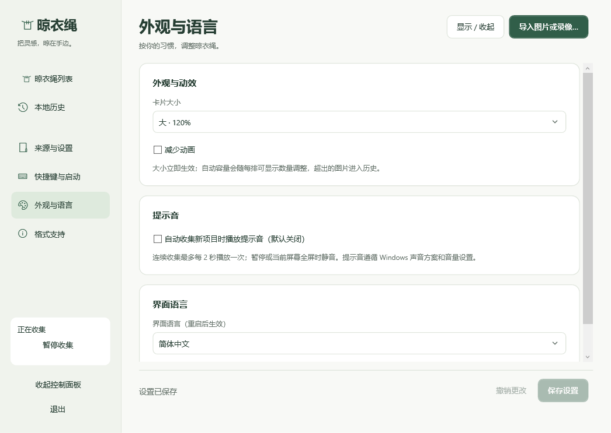

# Screenshot Clothesline for Windows

一个正在开发中的 Windows 截图与录像暂存工具：将图片和录像挂在屏幕顶部，方便复制、预览、拖出和找回历史，并支持图片标注。

An independently maintained Windows implementation of a screenshot clothesline, inspired by [Tendedero](https://github.com/alejandrobujan/tendedero).

> 当前状态：**v0.19.0 开发版**。展开时[先准备整排，再同时淡入](docs/SHELF_ENTRANCE.md)，减少动画时整排直接显示。采用[统一布局](docs/SHELF_ZONES.md)：图片、录像和文字共用一排连续位置，整体居中、统一间距与堆叠，图片及录像始终在文字左侧；数量按当前屏幕容量各限一半，超额只将同类最旧项移入历史；布局仍共用整条绳子的空间，两类各自排序。控制面板显示实际名额，不再选择固定容量。文字随机呈现[柔黄便利贴、撕边手账纸、线圈笔记本、极简索引卡](docs/TEXT_PAPER_STYLES.md)，悬停预览沿用纸张外观，编辑和重启后保持样式。新增[剪贴板文字卡片](docs/TEXT_CARDS.md)：与图片同尺寸，悬停阅读全文并可[直接在浮层编辑](docs/TEXT_HOVER_EDIT.md)，支持选取部分文字复制，修改后停止输入约 0.6 秒自动保存，移开保存并关闭，失败保留浮层和草稿；Ctrl+S 可提前保存。单击复制，双击的独立编辑入口保留。剪贴板图片与文字收集默认开启，可在“来源与设置”中关闭；升级时保留已保存的开关选择。保留[图片堆叠与悬停突出](docs/STACKED_SHELF.md)：拥挤时自动部分重叠，悬停卡片会置于前方并略微放大，继续停留显示完整大图。保留[图片悬停放大预览](docs/HOVER_PREVIEW.md)：停留约 0.4 秒显示完整大图，移开或操作卡片即收起。拖动时相邻照片向外倾斜让位，卡片跟随鼠标并平滑归位。支持[拖动排序与拖入图片](docs/DRAG_AND_DROP.md)，顺序重启后保留。沿用[新版控制面板](docs/DASHBOARD_DESIGN.md)和可选展开保护期（默认 10 秒）。默认 Ctrl + ↓ 显示晾衣绳、Ctrl + ↑ 收回，可分别修改或关闭，详见[快捷键说明](docs/DIRECTIONAL_SHORTCUTS.md)。视频用于挂绳、预览和文件流转，项目不提供视频剪辑；图片标注保留。完整兼容性仍有[待人工验收项目](docs/STAGE3_COMPATIBILITY.md)。


## 运行开发版

面向 Windows 11 x64。将 `Clothesline-0.19.0-win-x64.zip` 完整解压后运行 `Clothesline.exe`，无需安装 .NET。这是未签名的开发版，尚未提供正式安装器。

升级前先保存编辑并从托盘退出旧版。v0.13.0 首次打开 v1/v2 旧库时，先创建 `library-v1-backup-*.db` 或 `library-v2-backup-*.db` 数据库备份，再迁移至 v3，新增独立的显示顺序表；原有记录、设置与初始排列保留。迁移后的库不能直接用 v0.12 或更早版本打开；数据库备份不包含图片文件。详见[升级说明](docs/DRAG_AND_DROP.md#升级)。

- 首次启动会定位 Windows 截图目录；在“来源与设置”中核对路径，可另选最多三个目录。首次配置的目录只建立已有文件清单，之后收集新增或修改的图片，不递归子目录。
- Windows 截图工具保存新图片后，图片会挂到晾衣绳。未保存到文件的截图和复制的文字通过“收集剪贴板图片和文字”接收；**新配置默认开启**，可手动关闭。旧配置中已保存的开关值会保留，首次开启不补收之前复制的内容。旧图片可用“导入图片或录像…”手动加入。
- 鼠标在当前显示器顶部中央停留约 350 ms，或按 **Ctrl + ↓** 显示、**Ctrl + ↑** 收回。重复按同一快捷键不会反向切换。单击复制原图，双击用默认应用打开，拖出文件，滚轮翻页。
- 鼠标悬停图片卡片约 0.4 秒，旁边会浮现完整放大图；左右空间不足时放在下方。预览不抢焦点、不遮挡卡片；移开、点击、拖动或按 Esc 即收起。减少动画时仍可预览，录像卡片不触发。
- 晾衣绳为空时，悬停、快捷键或“显示 / 收起”仍会展开绳线，并显示一行“暂时没有图片”。加入图片后提示消失，取下最后一张后重新显示；离开后照常收起。
- “外观与语言 → 展开保护期”可选 5、10、15、30、60 秒，默认 10 秒。修改并保存后立即生效，已展开时按新时长重新计时。保护期结束且鼠标未进入晾衣绳时，再经过约 0.55 秒自动收起；鼠标停留或正在拖拽会继续显示。再按 Ctrl + ↓ 重新计时，Ctrl + ↑ 可主动收回。
- 拖出保存只允许复制副本，保存后原图和卡片继续保留。同盘与跨盘使用相同规则；按住 Shift 不会获得移动权限，目标可能拒绝放置。删除文件请使用右键“将文件移入回收站”。
- 按住卡片沿晾衣绳左右拖动，两侧照片会轻轻向外倾斜让位，松手后平滑归位，重启后保留。拖到左右屏幕边缘停留约 0.65 秒可翻页；新收集的图片仍放在最前，超容量仍按同类加入时间移入历史。
- 从资源管理器拖入图片：绳子已展开时拖到卡片附近；收起时拖到屏幕顶部中央，稍停出现投放区，再松手。支持多图（每次最多 100 个文件），同一文件不会重复挂载；历史中的图片可重新挂上。原文件保持原位置，外部拖入仅接收图片，不递归目录。
- 右键可定位、另存为、保存到桌面、取下或回收文件。取下、超出容量只转入历史；历史页可预览、重新挂上、导出或移除外部引用记录。
- 右键“预览与缩放”进入图片工作台；右键“编辑图片…”或按住卡片约 650 ms 进入编辑。工作台支持适应窗口、100%、Ctrl + 滚轮缩放、空格拖动、方向键切图，以及画笔、箭头、矩形、文字、马赛克、裁剪。文字工具先在输入框填写内容，再点击图片放置。
- Ctrl + Z / Y 撤销重做；“重置本次修改”恢复打开窗口时读入的图片。Ctrl + S 或“另存副本并挂上…”输出新的 PNG，同名文件自动编号。首次保存时同时保留原图 PNG 快照；再次编辑副本会沿用同一最初原图。重启后点击“恢复最初原图”可找回裁剪前的画面，恢复操作也可撤销，另存产生新副本。
- 编辑副本作为外部引用加入晾衣绳，遵循当前容量。快照在本地历史中标记为“编辑原版快照”，计入自管图片上限；还有副本记录依赖它时，不会被清理或回收。最后一个关联副本记录移除后，快照重新开始历史计时；默认永久保留。正在工作台使用的文件继续暂缓清理。
- 标注图层与逐步撤销栈仍仅在当前窗口内保留；跨会话恢复的是最初原图像素，不是逐步撤销上次的修改。旧版已经导出的副本无法追溯更早原图。动画图片只处理首帧，输出静态 PNG，不恢复动画或原始元数据。
- 右键可“取下左侧全部（跨页）”“取下右侧全部（跨页）”或“全部取下到历史”。左右范围按全部卡片的当前显示顺序计算（包括手动排序），不包括当前卡片；全部取下包括当前卡片。文件均保留，可从历史重新挂上。
- 容量始终按当前屏幕、DPI 和卡片大小计算；图片及录像、文字各最多一半（向下取整）。例如屏幕最多 20 项，已有 1 张图片和 10 条文字，再加入文字只替换最旧文字，图片保留。历史默认永久保留，可改为取下 7 或 30 天后清理。**外部文件到期只移除记录；应用保存的图片仅尝试移入回收站，失败保留记录。**
- 自管图片默认上限 512 MiB，可选 1/2 GiB；到达上限后停止新增剪贴板图片，外部引用不占此额度。暂停期间不自动收集，恢复后补扫来源目录。
- 关闭控制面板后应用留在托盘；通过托盘或面板“退出”结束应用。快捷键冲突时可使用托盘。同一会话内再次启动会唤起已有面板。
- 在“快捷键与启动”页分别设置显示、收回快捷键；需包含 Ctrl 或 Alt，可加 Shift，搭配字母、数字、Up/Down（↑/↓）或 F1–F24（不含 F12）。留空可单独关闭，两项不能相同。任一注册冲突或设置写入失败都会保留原来的两组快捷键；“重试当前注册”可在冲突解除后重试。
- 从旧版升级时，默认 Ctrl+Alt+T 自动改为 Ctrl+Down / Ctrl+Up；已关闭的保持关闭，自定义旧组合保留为显示键，收回默认 Ctrl+Up。按钮和托盘仍保留“显示 / 收起”切换。
- 登录启动默认关闭，主动开启并保存后，登录 Windows 时启动到托盘。移动便携包后须从新位置启动并重新保存设置。Windows 启动应用页可能另外禁用此项，应用不会自动重启被系统禁用的启动项。

- “外观与语言”提供小 80% / 标准 100% / 大 120% 卡片，保存后立即生效；两类名额随一排可显示的数量调整，各类超额最旧项目进入历史，扩大空间不会自动恢复历史。
- 自动收集提示音默认关闭，仅成功收集新图片时播放 Windows 提示音，每 2 秒最多一次；暂停和当前鼠标屏幕全屏时静音。手动导入、历史恢复、原图快照、重复与失败不发声。
- 可选择简体中文、English、Español、Français、Galego、Português (Brasil)、日本語、한국어、Türkçe、Azərbaycanca、हिन्दी，保存后重启生效。先保存未完成编辑，再从托盘退出并重新打开；界面会显示重启提示。

- 卡片入场时短暂摆动，鼠标进入时立即停稳。取下动画期间鼠标立即穿透，结束后关闭；收起时立即隐藏。勾选“减少动画”或关闭 Windows 客户端动画可关闭这些效果。
- 编辑器的粗细滑块获得焦点后，方向键用于调节粗细；文字框内仍用于移动光标。
- “键盘浏览晾衣绳”打开可聚焦的列表：方向键选择，Enter 预览，Ctrl+C 复制，Delete 取下到历史；文件仍保留。Tab 可到达编辑、导出等按钮。
- 图片工作台可用 Alt+C 聚焦画布，方向键按原图像素移动光标，Shift 加速。先选择工具，再用 Enter 开始/完成画笔、箭头、矩形、马赛克或裁剪；文字工具按 Enter 放置文字。Esc 先取消当前标注，再关闭窗口。
- 锁屏、挂起和远程断开会收起晾衣绳；恢复后重置显示器位置并补扫来源。虚拟桌面仅使用公开 Windows 接口跟随当前前台窗口，不切换或固定用户桌面。实际多桌面和远程场景仍待实测。

- 在“来源与设置”填写可选的录像目录并保存，开始收集新增 MP4；首次配置跳过旧录像，不包含子目录。留空关闭；旧录像可手动导入。
- 当前支持 H.264 视频、AAC 音频或无音轨，单文件不超过 2 GiB，尺寸不超过 3840 × 2160（支持竖屏）。不支持或仍在写入的文件保留并显示原因。
- 录像卡片显示时长和播放标记；单击复制文件，双击默认应用打开，长按或右键播放。内置预览初始暂停，支持播放/暂停、进度、静音与音量，Esc 关闭。
- 录像复制、拖出和另存均复制完整原文件，保留源文件与卡片；取下、超容量和历史规则与图片共用。视频预览只提供播放、进度、音量和默认应用入口，不提供选区、剪辑或转码。开始使用录像后请继续使用 v0.6 或更新版本，旧版不能识别录像卡片。

WebP、HEIC/HEIF 可从截图目录、额外目录和手动导入进入同一图片流程。升级时已有文件跳过，之后收集新增或修改的文件；复制提供 PNG、位图和原文件，拖出/原格式导出保留原文件，编辑另存 PNG 并保留原图像素快照。只处理首帧或主图，不保留动画、全部容器元数据或多图序列。解码失败时显示原因，文件保留；应用不自动安装图像扩展。

设置、记录与应用保存的 PNG 位于 `%LOCALAPPDATA%\ScreenshotClothesline\Library`，重启后恢复。外部图片只保存引用，移动或删除原文件会导致失效。阶段 0 的示例目录独立保留，不自动导入本地历史。

支持 PNG、JPEG、BMP、TIFF、GIF 首帧；WebP、HEIC/HEIF 依赖本机 Windows 图像组件。控制面板新增“格式支持”，用内置小样本实际解码检测，可重新检测；样本成功不代表所有变体均支持。当前限制单文件 64 MiB、4000 万像素。首次目录清单与后续补扫基于路径、大小和修改时间；跨来源像素去重窗口为 5 秒，不能保证延迟很长的双来源事件合并。全屏判断采用窗口几何启发式。限制及实测范围见 [阶段 1 验证报告](docs/STAGE1_VALIDATION.md)。



控制面板左侧切换晾衣绳、本地历史和各组设置。编辑设置后，底部提示未保存，可跨页面继续填写，再统一保存或撤销；收起面板会保留当前草稿。本地历史支持按文件名或路径搜索，导出、定位和取下等操作收进“更多操作”。

## 构建与验证

安装 .NET 10 SDK（x64），在仓库根目录执行：

```powershell
./scripts/build.ps1
./scripts/test.ps1
./scripts/run.ps1
./scripts/publish.ps1
```

所有脚本支持 `-Dotnet '完整路径\dotnet.exe'`。便携包输出到 `dist/Clothesline-0.19.0-win-x64.zip`，SHA-256 校验和位于 `dist/SHA256SUMS-0.19.0.txt`。

普通测试包含核心规则、SQLite 生命周期、100 文件监听突发测试、屏幕名额与旧配置兼容、整排入场、浮层编辑和四种纸张的离屏渲染检查（不显示屏幕内测试窗口）。有交互式 Windows 桌面时，先退出正在运行的应用，再执行 `./scripts/test.ps1 -Desktop`：会短暂显示本程序专用测试窗口，检查跨进程窗口命中、100 张生成的有效 PNG、导出和原生回收站。结果与自身界面渲染位于 `artifacts/validation/` 和 `artifacts/stage1-validation/`。该命令不采集屏幕图像、不修改系统剪贴板；回收站测试仅处理生成的夹具文件。

编辑诊断同时检查标注渲染、裁剪坐标、撤销重做、原图保留、同名副本保存和工作台文件保护，结果位于 `artifacts/stage2-validation/`。这些测试不代替真实鼠标手势与保存对话框人工验收。

v0.3.0 追加原图快照关联、迁移、配额、重启恢复与清理检查。设置诊断在 `artifacts/preferences-validation/`，使用临时快捷键和隔离注册表键验证冲突/回滚，不修改用户真实登录启动项，不发送键盘输入。

v0.4.0 新增 `--appearance-test artifacts/appearance-validation`，验证三档尺寸、无障碍名称、中英文自身界面及设置保存。`test.ps1 -Desktop` 已包含此诊断。提示音策略和事件测试不播放实际系统声音，试听仍待人工完成。

v0.5.0 新增 `--motion-test artifacts/motion-validation`，检查动画生命周期、退场穿透、快速更新清理、历史提交与键盘路由；已纳入 `test.ps1 -Desktop`。该命令会短暂显示本程序专用窗口。

v0.6.0 新增录像专项诊断（--video-test），使用原生编码器生成测试录像，检查实际解码、播放、缩略图、文件操作与历史生命周期。已纳入桌面诊断；不写真实剪贴板，实际跨应用粘贴、音轨和拖放仍需人工验收。

v0.8.0 新增图片格式专项诊断（--image-format-test），检查本机样本能力、WebP 透明度、首帧、缩略图、HEIF 别名、文件保护与编辑快照，以及缺组件的模拟错误分支。结果位于 artifacts/image-format-validation/；已纳入桌面诊断。运行程序不需要 Python，仓库的生成样本脚本仅用于开发重建测试素材。

GitHub Actions 尚未启用；[CI 模板](docs/ci/build.yml.example) 已准备好，将执行构建、核心规则检查与打包。当前推送凭据没有 `workflow` 权限，因此模板暂放在文档目录，待具备相应权限后再安装到 `.github/workflows/build.yml`。

v0.12.0 新增 `--dashboard-test artifacts/dashboard-validation`，使用生成素材与隔离数据库检查页面导航、草稿保存/撤销、历史搜索、下拉框与 11 种语言的小窗口布局，已纳入 `test.ps1 -Desktop`。

v0.16 系列新增 `--text-card-test artifacts/text-card-validation`，检查文字收集数据、完整复制、可滚动悬停预览、编辑保存、历史恢复和原生 TXT 拖出。数据库升级至 v4，升级前自动备份；旧版程序不能打开升级后的库。

v0.15.0 新增 `--stacked-shelf-test artifacts/stacked-shelf-validation`，检查堆叠层次、悬停突出、相邻切换、两段预览、拖动衔接、分页和生命周期。

v0.14.0 新增 `--hover-preview-test artifacts/hover-preview-validation`，检查悬停计时、异步切图、位置、鼠标穿透、交互取消和有界图片解码。

v0.13.1 新增 `--reorder-motion-test artifacts/reorder-motion-validation`，检查向外倾斜、跟随、归位、快速反向、跨页、取消及动画清理。原有 `--drag-drop-test artifacts/drag-drop-validation`，检查拖入、持久排序、分页、容量、原文件保留和原生 Shell 数据与 WPF 事件互通。使用隔离库，不移动用户鼠标；真实 Explorer 手势仍按[人工清单](docs/DRAG_AND_DROP.md#人工验收)验证。

## 已确定的方向

- 首发面向 **Windows 11 x64**。
- 参考原版 macOS Tendedero 的功能及交互，以 Windows 原生能力重新实现。
- 不参考、不复用现有 Windows 移植项目的源码或实现方案。
- 截图超出晾衣绳容量后进入本地历史，按独立的保留期限清理。
- 本地运行，无账号和遥测。

## 文档

- [需求规格](docs/REQUIREMENTS.md)：功能、文件生命周期、默认值及验收标准。
- [迁移计划](docs/MIGRATION_PLAN.md)：技术方案、模块边界和实施阶段。
- [四种随机纸张](docs/TEXT_PAPER_STYLES.md)：文字卡片外观、稳定分配规则与体验清单。
- [浮层文字编辑](docs/TEXT_HOVER_EDIT.md)：悬停预览中的编辑、保存、草稿保护和键盘操作。
- [阶段 0 验证报告](docs/STAGE0_VALIDATION.md)：已验证行为、性能采样与待人工验收项。
- [阶段 1 验证报告](docs/STAGE1_VALIDATION.md)：收集、文件生命周期、持久化与便携包验证。
- [阶段 2 验证报告](docs/STAGE2_VALIDATION.md)：图片工作台、编辑边界与待人工核验清单。
- [阶段 2 第二批验证报告](docs/STAGE2_ORIGINALS_PREFERENCES.md)：原图恢复、快捷键、登录启动及升级说明。
- [阶段 2 第三批验证报告](docs/STAGE2_APPEARANCE_LANGUAGE.md)：大小、音效、中英文界面及待人工核验清单。
- [阶段 2 第四批验证报告](docs/STAGE2_MOTION.md)：动效、减少动画、键盘修正与完整人工核验清单。
- [阶段 3 第一批报告](docs/STAGE3_VIDEO.md)：录像使用方式、编码与资源边界、验证结果及人工清单。
- [阶段 3 第三批报告](docs/STAGE3_IMAGE_FORMATS.md)：可选图片格式、能力检测、验证结果和人工核验清单。
- [阶段 3 第四批报告](docs/STAGE3_COMPATIBILITY.md)：兼容性状态矩阵、图片解码隔离、性能记录、键盘与语言、剩余人工清单。
- [视频暂存范围说明](docs/VIDEO_SCOPE.md)：v0.10 的视频边界、移除内容、旧文件兼容与验证。
- [新版控制面板](docs/DASHBOARD_DESIGN.md)：v0.12 的布局、操作方式与验证结果。
- [来源与授权说明](THIRD_PARTY_NOTICES.md)：原项目基线、参考范围和品牌限制。
- [贡献说明](CONTRIBUTING.md)：开发与贡献约定。

## 技术方案

C#、.NET 10 LTS、WPF、Win32/COM 接口、Microsoft.Data.Sqlite。

绳线和每张卡片各有独立窗口，隐藏时调用真正的窗口隐藏。平台与界面实现在 App，坐标、显示时序和拖拽结果规则在 Core，目录收集、去重、SQLite 和文件生命周期在 Storage。剪贴板图片以 `.part` 写入、刷新并重命名；回收前记录操作，启动时恢复未完成状态。

## 开发阶段

- [ ] 阶段 0：桌面交互原型（可运行，待完成验收矩阵）
- [ ] 阶段 1：截图收集、复制、拖拽与历史闭环（已实现开发版，人工验收待完成）
- [ ] 阶段 2：预览、标注、批量取下、原图恢复、快捷键与登录启动已实现；大小/音效、中英文及基础无障碍名称已实现；动效已实现；用户本机关键流程反馈正常，完整兼容性矩阵与性能目标待完成
- [ ] 阶段 3：录像暂存与预览、扩展格式、桌面恢复、解码隔离、键盘操作与 11 种语言已实现；视频剪辑不属于项目范围；真实环境完整验收仍待继续
- [ ] 阶段 4：安装、升级与正式发布

## 项目关系与许可证

本项目由独立维护者开发，与 Tendedero 作者无隶属或背书关系。Tendedero 的名称、图标和文档图片不作为本项目的品牌或素材使用。

本仓库自身代码的发布许可证待确定；公开仓库不等于已授予开源许可。当前实现未复制原项目源码。后续如移植或改写原项目源码，将保留适用的原作者版权声明与完整 MIT 许可文本。详情见 [来源与授权说明](THIRD_PARTY_NOTICES.md)。

### v0.9 追加诊断

`./scripts/test.ps1 -Desktop -Soak` 运行已有回归、兼容性诊断、性能采样与 60 轮恢复/取下循环。测试使用生成素材及隔离数据库，不读取个人截图。性能目标与人工项目以本批报告为准，不把自动检查当作真实拖放、物理拔插或 Narrator 听读验收。
