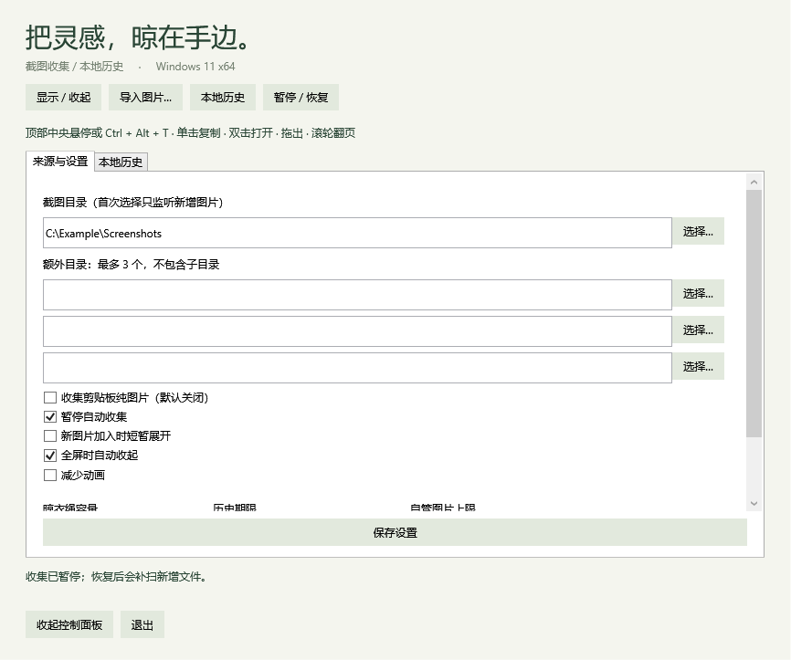

# Screenshot Clothesline for Windows

一个正在开发中的 Windows 截图暂存工具：将截图挂在屏幕顶部，方便复制、预览、编辑、拖出和找回历史。

An independently maintained Windows implementation of a screenshot clothesline, inspired by [Tendedero](https://github.com/alejandrobujan/tendedero).

> 当前状态：**阶段 1 的 v0.1.0 开发版已接入真实图片收集与本地历史。** 自动化检查通过，跨应用拖放、真实剪贴板和混合 DPI 等人工验收尚未完成。仓库名称为开发工作名，正式应用名称与图标待定。


## 运行开发版

面向 Windows 11 x64。将 `Clothesline-0.1.0-win-x64.zip` 完整解压后运行 `Clothesline.exe`，无需安装 .NET。这是未签名的开发版，尚未提供正式安装器。

- 首次启动会定位 Windows 截图目录；在“来源与设置”中核对路径，可另选最多三个目录。首次配置的目录只建立已有文件清单，之后收集新增或修改的图片，不递归子目录。
- Windows 截图工具保存新图片后，图片会挂到晾衣绳。未保存到文件的截图可通过主动开启“收集剪贴板纯图片”接收；**剪贴板收集默认关闭**。旧图片可用“导入图片…”手动加入。
- 鼠标在当前显示器顶部中央停留约 350 ms，或按 **Ctrl + Alt + T** 显示/收起。单击复制原图，双击用默认应用打开，拖出文件，滚轮翻页。
- 右键可定位、另存为、保存到桌面、取下或回收文件。取下、超出容量只转入历史；历史页可预览、重新挂上、导出或移除外部引用记录。
- 默认按屏幕宽度决定容量，可选择 25/50/100 项。历史默认永久保留，可改为取下 7 或 30 天后清理。**外部文件到期只移除记录；应用保存的图片仅尝试移入回收站，失败保留记录。**
- 自管图片默认上限 512 MiB，可选 1/2 GiB；到达上限后停止新增剪贴板图片，外部引用不占此额度。暂停期间不自动收集，恢复后补扫来源目录。
- 关闭控制面板后应用留在托盘；通过托盘或面板“退出”结束应用。快捷键冲突时可使用托盘。同一会话内再次启动会唤起已有面板。

设置、记录与应用保存的 PNG 位于 `%LOCALAPPDATA%\ScreenshotClothesline\Library`，重启后恢复。外部图片只保存引用，移动或删除原文件会导致失效。阶段 0 的示例目录独立保留，不自动导入本地历史。

支持 PNG、JPEG、BMP、TIFF、GIF 首帧；当前限制单文件 64 MiB、4000 万像素。首次目录清单与后续补扫基于路径、大小和修改时间；跨来源像素去重窗口为 5 秒，不能保证延迟很长的双来源事件合并。全屏判断采用窗口几何启发式。限制及实测范围见 [阶段 1 验证报告](docs/STAGE1_VALIDATION.md)。



## 构建与验证

安装 .NET 10 SDK（x64），在仓库根目录执行：

```powershell
./scripts/build.ps1
./scripts/test.ps1
./scripts/run.ps1
./scripts/publish.ps1
```

所有脚本支持 `-Dotnet '完整路径\dotnet.exe'`。便携包输出到 `dist/Clothesline-0.1.0-win-x64.zip`，SHA-256 校验和位于 `dist/SHA256SUMS-0.1.0.txt`。

普通测试包含核心规则、SQLite 生命周期和 100 文件监听突发测试。有交互式 Windows 桌面时，先退出正在运行的应用，再执行 `./scripts/test.ps1 -Desktop`：会短暂显示本程序专用测试窗口，检查跨进程窗口命中、100 张生成的有效 PNG、导出和原生回收站。结果与自身界面渲染位于 `artifacts/validation/` 和 `artifacts/stage1-validation/`。该命令不采集屏幕图像、不修改系统剪贴板；回收站测试仅处理生成的夹具文件。

GitHub Actions 尚未启用；[CI 模板](docs/ci/build.yml.example) 已准备好，将执行构建、核心规则检查与打包。当前推送凭据没有 `workflow` 权限，因此模板暂放在文档目录，待具备相应权限后再安装到 `.github/workflows/build.yml`。

## 已确定的方向

- 首发面向 **Windows 11 x64**。
- 参考原版 macOS Tendedero 的功能及交互，以 Windows 原生能力重新实现。
- 不参考、不复用现有 Windows 移植项目的源码或实现方案。
- 截图超出晾衣绳容量后进入本地历史，按独立的保留期限清理。
- 本地运行，无账号和遥测。

## 文档

- [需求规格](docs/REQUIREMENTS.md)：功能、文件生命周期、默认值及验收标准。
- [迁移计划](docs/MIGRATION_PLAN.md)：技术方案、模块边界和实施阶段。
- [阶段 0 验证报告](docs/STAGE0_VALIDATION.md)：已验证行为、性能采样与待人工验收项。
- [阶段 1 验证报告](docs/STAGE1_VALIDATION.md)：收集、文件生命周期、持久化与便携包验证。
- [来源与授权说明](THIRD_PARTY_NOTICES.md)：原项目基线、参考范围和品牌限制。
- [贡献说明](CONTRIBUTING.md)：开发与贡献约定。

## 技术方案

C#、.NET 10 LTS、WPF、Win32/COM 接口、Microsoft.Data.Sqlite。

绳线和每张卡片各有独立窗口，隐藏时调用真正的窗口隐藏。平台与界面实现在 App，坐标、显示时序和拖拽结果规则在 Core，目录收集、去重、SQLite 和文件生命周期在 Storage。剪贴板图片以 `.part` 写入、刷新并重命名；回收前记录操作，启动时恢复未完成状态。

## 开发阶段

- [ ] 阶段 0：桌面交互原型（可运行，待完成验收矩阵）
- [ ] 阶段 1：截图收集、复制、拖拽与历史闭环（已实现开发版，人工验收待完成）
- [ ] 阶段 2：预览、标注、批量操作与设置
- [ ] 阶段 3：录像处理与兼容性
- [ ] 阶段 4：安装、升级与正式发布

## 项目关系与许可证

本项目由独立维护者开发，与 Tendedero 作者无隶属或背书关系。Tendedero 的名称、图标和文档图片不作为本项目的品牌或素材使用。

本仓库自身代码的发布许可证待确定；公开仓库不等于已授予开源许可。当前实现未复制原项目源码。后续如移植或改写原项目源码，将保留适用的原作者版权声明与完整 MIT 许可文本。详情见 [来源与授权说明](THIRD_PARTY_NOTICES.md)。
