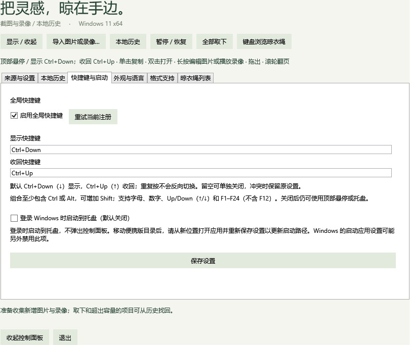

# 独立显示与收回快捷键

2026-10-26，v0.11.0。

默认 **Ctrl + ↓ 显示**、**Ctrl + ↑ 收回**。显示时再按显示键仍然显示，隐藏时再按收回键仍然隐藏；按住不重复触发。顶部悬停、离开收起、按钮和托盘的切换方式继续保留。空绳仍可显示“暂时没有图片”。锁屏、挂起、全屏抑制和正在拖拽时的保护继续生效。

2026-10-27（v0.12 开发版）调整：“外观与语言 → 展开保护期”可选 **5、10、15、30、60 秒**，默认 **10 秒**。修改并保存后立即生效，已经展开时按新时长重新计时；撤销不改动当前计时设置。保护期结束且鼠标不在晾衣绳区域时，经过约 0.55 秒自动收起；重复按显示键重新开始所选保护期。悬停展开、按钮展开和新项目展开共用这一计时规则。主动收回与全屏/会话保护继续生效。选择会保存到本地，旧配置缺少该字段时使用 10 秒。

“快捷键与启动”提供两个输入框。支持 `Ctrl+Down`、`Ctrl+Up` 或 `Ctrl+↓`、`Ctrl+↑` 写法，保存后统一为 Up/Down。可用字母、数字、F1–F24（F12 除外）及 Up/Down，至少包含 Ctrl 或 Alt，可附加 Shift。两项可互换，不能使用相同组合；留空单独关闭，取消“启用全局快捷键”同时关闭。

保存时先注册所有新组合，再写入设置，成功后释放旧组合。任一组合冲突、登录启动设置失败或数据库保存失败，都保留原来的两组快捷键。启动时若只有一组被占用，另一组仍可用；提示显示具体失败的动作，冲突解除后可重试。

## 升级

- 旧默认 Ctrl+Alt+T → 显示 Ctrl+Down、收回 Ctrl+Up。
- 旧版关闭快捷键 → 两项保持关闭。
- 旧版自定义组合 → 保留为显示键，收回使用 Ctrl+Up。
- 已有新版两项设置 → 保留，包括单独关闭的项目。

不修改媒体记录或数据库结构。设置保存为 `ShowShortcut` 和 `HideShortcut`，旧 `Shortcut` 字段仅用于读取迁移；保存后不再写入。若之后回到旧程序，旧程序不认识这两个字段。

## 验证

Release 构建 0 警告、0 错误。相关回归 **360 项通过**：Core 143、Storage 107、Preferences 27、Functional compatibility 83，见[汇总](evidence/v0.11-summary.json)与[快捷键专项](evidence/v0.11-preferences.json)。

覆盖上下键解析、重复显示/收回、锁屏阻止显示、两组互换、单独关闭、第二组冲突时释放第一组候选、数据库/登录启动失败回滚、启动时部分冲突与重试，以及旧默认、关闭、自定义和新版配置的保存与重启。原生注册诊断使用独立组合，登录启动检查使用隔离测试项；不改动用户的登录启动设置。

设置页渲染已核对，全部 11 种语言的资源完整性与格式参数检查通过。

功能兼容性检查明确排除需要前台激活的四项夹具；本次不改变原有真实环境人工验收范围。

