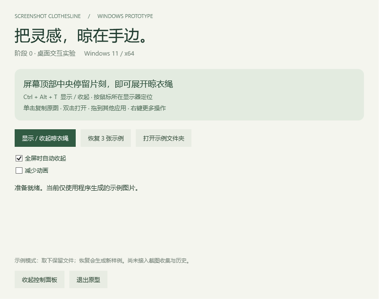

# 阶段 0：原型与验证记录

日期：2026-10-22。结论：原型可构建、可运行；核心规则与桌面命中检查通过。**阶段 0 还没有完成全部验收，不进入真实截图收集阶段。**

检查均在本机执行。GitHub Actions 暂未启用：当前 GitHub 凭据缺少 `workflow` 权限，已将 CI 保留为 `docs/ci/build.yml.example` 模板，没有改动账号授权。

## 本次范围

- .NET 10 / WPF、单实例、托盘入口和控制面板。
- 三张原创 960 × 600 PNG 示例；绳线与卡片分别使用透明工具窗口。
- 顶部中央悬停、Ctrl + Alt + T、离开延迟、减少动画、全屏抑制开关。
- 复制原图、默认程序打开、Shell 文件拖拽、取下、回收站操作入口。
- Per-Monitor V2、物理像素定位、显示器变化时重置位置。
- 所有示例留在本机；没有截图目录或剪贴板监听、数据库、历史、编辑器、录像或登录启动。

## 实现要点

绳线窗口使用 layered + `WS_EX_TRANSPARENT`，卡片使用独立的 `WS_EX_NOACTIVATE | WS_EX_TOOLWINDOW` 窗口。卡片之间不存在覆盖输入的卡片窗口；不用 `HTTRANSPARENT` 的同线程语义来推断跨进程穿透。隐藏状态调用 `Hide()`，顶部触发由低频鼠标位置轮询识别。

显示器坐标始终使用物理像素。先将待显示窗口放入目标显示器再读取 `GetDpiForWindow`，随后计算卡片矩形。100%–200% 的纯坐标规则有测试；实际混合 DPI 仍是独立验收项。

拖拽通过 `SHCreateDataObject` 提供 Shell 文件身份，再用 `SHDoDragDrop` 交付。取消保留源文件；文件确实移走才取下卡片。目标报告 MOVE 而源文件仍在时，显示提示并保留源文件。回收站目标通过 TargetCLSID 识别，平台文件操作负责回收。没有根据单独的 MOVE 返回值直接删除文件的逻辑。

因此，尚未验证的非优化移动可能表现为“目标有副本、源文件仍保留”，这是当前明确的兼容性缺口。回收站入口使用 Windows 自带确认/错误界面，不自行回退到永久删除。

## 环境与已完成检查

- Windows 11 x64，系统 build 22631；SDK 10.0.402，运行时 10.0.13。
- 屏幕 A：2560 × 1600，原点 (0, 0)，150%。
- 屏幕 B：3840 × 2160，原点 (2560, -223)，150%。
- Release 构建：0 警告、0 错误。
- 33 项核心规则检查通过：悬停/隐藏时序、拖拽期间不误展开、负坐标、多档缩放布局、全屏几何排除、复制/移动/取消/回收站状态决策。
- 11 项桌面断言通过：显示不改变前台窗口、绳线/间隙命中另一进程的测试背景、卡片可命中、物理矩形准确、工具窗口/不激活标志、两屏定位、真正隐藏、快捷键冲突可识别。
- 自包含 EXE 在清除 `DOTNET_ROOT` 后成功启动；再次启动的进程以 0 退出，仅保留一个应用实例。启动时常规应用进程工作集约 122 MiB。这仍不能替代干净虚拟机验收。
- 使用 WPF 渲染本程序控件检查布局；示例预览见下图。渲染图不等于实机桌面截图。




## 性能采样的范围

一次桌面诊断运行的记录：预热后 5 秒空闲采样没有记录到 CPU 时间增量（不代表 CPU 使用恒为零），诊断进程工作集约 151 MiB；冷态整条晾衣绳显示调用约 126 ms，已建立窗口后的单卡显示调用约 6 ms。该次原始结果保存在 [诊断记录](evidence/stage0-diagnostics.json)。

这些是本机短样本，不是性能保证。诊断进程同时分配了测试窗口和渲染资源，不能代表最终常驻内存；显示调用耗时不包括合成器呈现、输入轮询与 350 ms 悬停等待。后续应在独立常驻进程和目标硬件上记录长时间分位数。原始日志由 `scripts/test.ps1 -Desktop` 生成在 `artifacts/validation/diagnostics.json`。

## 尚待人工验收

本次桌面自动化工具初始化失败，因此没有把真实鼠标/键盘操作或应用间交互记为已验证。下表是阶段 0 关闭前的必测项：

| 场景 | 通过标准 | 当前状态 |
|---|---|---|
| 浏览器、资源管理器、编辑器 | 显示与隐藏时都不挡无卡片区域的标签页/控件；点击卡片不夺取下方输入焦点 | 待实测；只完成专用窗口命中/显示焦点检查 |
| 悬停、快捷键与托盘 | 边缘短暂经过不展开；可展开、收起；冲突有反馈；关闭面板后能从托盘恢复 | 状态规则/注册已测，完整操作待实测 |
| 复制与双击 | 多个目标可粘贴原图；双击不会先改剪贴板；文件仍可打开 | 待实测 |
| 拖到资源管理器 | 同盘/跨盘、Ctrl 复制、Shift 移动，检查两边文件和原图哈希 | 待实测 |
| 拖到聊天/浏览器上传区 | 接收真实文件；成功、拒收、Esc 取消均保留一致状态 | 待实测 |
| 回收站 | 拖入与右键回收入口、确认取消、从系统回收站恢复；只用生成样例 | 待实测 |
| 两屏 100%/150%/200% 混合 | 切屏尺寸正确、负坐标无偏移、触发条在正确屏幕 | 当前双屏都是 150%；混合缩放待实测 |
| 拔插、睡眠、重连 | 位置恢复、无屏外残留窗口、快捷键/托盘继续可用 | 处理代码已接入，待实测 |
| 普通最大化、F11 视频/浏览器、游戏 | 最大化不误抑制；全屏时收起；拖拽途中不打断 | 几何规则通过，应用兼容性待实测 |
| 无 SDK 的干净 Windows 11 | 解压运行、重复启动、退出；运行时与通知齐全 | 自包含包已生成，干净虚拟机待实测 |

原型不持久化设置/卡片状态；恢复示例和重启生成新文件，需从示例目录自行整理。本阶段不验证正式产品的历史清理规则。

## 复验

```powershell
./scripts/test.ps1          # 编译 + 核心规则
./scripts/test.ps1 -Desktop # 本程序专用窗口的跨进程检查与界面渲染
./scripts/publish.ps1       # 自包含 x64 包 + 运行时许可
```

自动桌面检查会短暂创建一个独立背景进程与原型窗口，不注入鼠标键盘输入，不读取其他应用内容，不抓取屏幕，不写剪贴板。运行时请保持桌面处于可交互状态，避免同时手动切换前台窗口而干扰焦点断言。

## 官方实现依据

- [Windows 窗口与 layered window 命中行为](https://learn.microsoft.com/en-us/windows/win32/winmsg/window-features)
- [每窗口 DPI](https://learn.microsoft.com/en-us/windows/win32/api/winuser/nf-winuser-getdpiforwindow)
- [Shell 数据传递场景与回收站](https://learn.microsoft.com/en-us/windows/win32/shell/datascenarios)
- [SHCreateDataObject](https://learn.microsoft.com/en-us/windows/win32/api/shlobj_core/nf-shlobj_core-shcreatedataobject)
- [SHDoDragDrop](https://learn.microsoft.com/en-us/windows/win32/api/shlobj_core/nf-shlobj_core-shdodragdrop)
- [WFO0003](https://learn.microsoft.com/en-us/dotnet/desktop/winforms/compiler-messages/wfo0003)：此程序由 WPF 启动并通过 manifest 声明 PMv2，只借用 WinForms 的 NotifyIcon，故定点关闭该 WinForms 启动配置警告。
