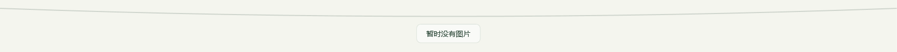
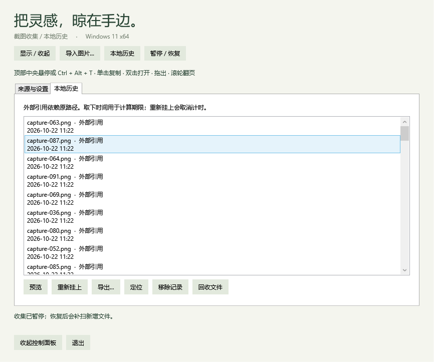

# 阶段 1 验证报告

日期：2026-10-22。版本：0.1.0 开发版。阶段 0 PR #1 已合并，阶段 1 的实现位于后续功能分支。未参考已有 Windows 移植项目。

## 实现范围

- Windows 已知截图目录和最多三个额外目录的非递归监听；首次已有文件基线、写入稳定检测、重试、30 秒补扫、暂停与恢复。
- 可选纯图片剪贴板监听，默认关闭；过滤文本、HTML、文件列表、自身写入及已知隐私标记。启用时不读取已有剪贴板内容。
- 像素规范化 SHA-256 去重；同路径重复事件合并，跨来源采用 5 秒窗口。同一来源的不同文件允许保留相同画面。
- SQLite v1 设置与记录持久化；外部引用与应用保存文件分开处理。剪贴板 PNG 先写 `.part`，刷新后重命名；启动校验未完成写入与回收操作。
- 容量自动或 25/50/100 项、滚轮翻页、取下转入历史、历史恢复、基础预览、定位和不覆盖的导出。
- 历史默认永久保留，可选 7/30 天。到期仅清除外部记录；自管文件使用原生回收站，失败保留错误记录供手动重试。回收前日志与删除回调阻止永久删除回退。
- 自管图片默认上限 512 MiB，可选 1/2 GiB。文件操作期间暂停后台清理及相关界面刷新。当前只保存并恢复配置和列表，不导入阶段 0 示例。

## 验证环境与结果

本机 Windows 11 23H2 x64，build 22631；.NET SDK 10.0.402、运行时 10.0.13。两个显示器均为 150%：2560×1600 与 3840×2160，第二屏 Y=-223。没有混合 DPI 实测证据。

执行 `./scripts/test.ps1 -Desktop`，构建 0 警告、0 错误。包含空晾衣绳与提示在内的完整复验 108 项全部通过。

| 检查组 | 数量 | 覆盖范围 |
|---|---:|---|
| Core | 33 | 坐标、触发时序、全屏几何规则、拖拽结果规则 |
| Storage | 42 | SQLite 生命周期、100 文件突发监听、去重、暂停/恢复、重启、未完成写入/回收恢复、原子写入、存储上限、剪贴板格式策略 |
| Desktop | 19 | 不改变焦点、绳线与空隙跨进程命中、卡片命中、物理坐标、两屏位置、隐藏、快捷键冲突、空晾衣绳提示、提示鼠标穿透及空/有图片切换 |
| Library integration | 14 | 100 张有效 PNG、25 张在绳上/75 张历史、外部文件保留、恢复、缩略图、无覆盖导出、PNG 管线、双来源去重、原生回收与永久删除拒绝 |

桌面检查前关闭了仍在运行的阶段 0 原型；该旧实例曾占用快捷键并干扰命中检查。独立运行复测通过，快捷键初始注册成功。

原始证据：[桌面检查 JSON](evidence/stage1-desktop-diagnostics.json)、[图片与回收集成 JSON](evidence/stage1-diagnostics.json)。测试均使用生成的夹具，未上传个人图片或数据库。剪贴板管线测试直接传入生成的 PNG，**没有操作系统剪贴板**，不等同于真实监听、复制与粘贴验收。

空列表反馈复验：[19 项桌面检查 JSON](evidence/stage1-empty-reveal-diagnostics.json)。没有图片时仍可展开绳线，在绳线下方显示一行“暂时没有图片”；提示与绳线共用不激活、可穿透窗口。加入图片后隐藏提示，移除最后一张后恢复提示，离开后照常收起。检查覆盖不打开控制面板、不改变前台焦点、不添加示例，以及提示位置的跨进程鼠标穿透。这些检查直接调用程序显示入口，未注入真实按键；本轮快捷键初始注册成功，实际按键与悬停触发仍需人工核验。

初版桌面诊断的单次采样：隐藏 CPU 为 0%（单逻辑核心口径，预热 2 秒后采样 5 秒）、工作集约 156 MiB、首次显示调用约 188 ms、热态单卡约 14 ms。进程包含测试界面分配，显示调用时间不包含输入与合成器延迟，不能视为完整应用性能保证。

## 便携包

由 `scripts/publish.ps1` 生成 win-x64 自包含目录、ZIP 与 SHA-256；附带准确版本的 NuGet 元数据、依赖许可与运行时通知。运行方式为完整解压后启动 `Clothesline.exe`。本机无 .NET 10 系统安装，但有开发用私有 SDK；不设置 `DOTNET_ROOT` 的直接启动与单实例检查结果记录于 [便携包检查](evidence/stage1-package.json)。干净虚拟机仍待验证。

## 界面证据

以下是程序自身控件的渲染，不是整个桌面的截图。只使用生成的图片，目录显示为示例路径。

## 仍需验收与限制

- 真实 Windows 截图工具 → 监听 → 单击复制/粘贴 → 拖出 → 取下 → 历史恢复的人工全流程；浏览器上传框、资源管理器同盘/跨盘移动、Office 和实际聊天软件的拖放矩阵。
- 本次电脑操作工具初始化失败，因此未通过工具驱动真实桌面点击或剪贴板操作；自动化证据不能替代这些项目。
- 100%/150%/200% 混合 DPI、屏幕拔插、虚拟桌面、睡眠/唤醒、屏幕共享、全屏游戏与视频、受支持 Windows 11 版本的干净环境。
- 当前文件监听队列串行进行稳定性与图片检查，100 文件测试验证最终完整性，不承诺每项都在 500 ms 内显示。大图库的扫描和历史界面性能还需采样。
- 外部引用依赖原路径；同名文件被修改后引用显示当前文件，不保存外部原版快照。首次基线和补扫按路径、大小与修改时间识别变化。
- 已启用源目录在应用退出或暂停期间新增的图片会在恢复时补扫。移除后再次配置同一目录也可能补收期间的新图片。
- 跨来源去重只覆盖处理时间相近的事件，排队很久的同图仍可能重复；读取异常图片会重试并显示状态提示。
- 图片限 64 MiB 和 4000 万像素，支持 PNG/JPEG/BMP/TIFF/GIF 首帧。WebP、HEIC、视频、编辑、完整预览与键盘操作仍在后续阶段。
- 当前界面为简体中文，快捷键固定。正式名称、仓库自身许可证、安装器、代码签名和升级仍待后续处理。
- GitHub Actions 未启用，`docs/ci/build.yml.example` 仅是模板；本报告来自本地测试。

阶段 1 已具备可运行的收集与历史开发版，人工兼容性验收尚未完成。
