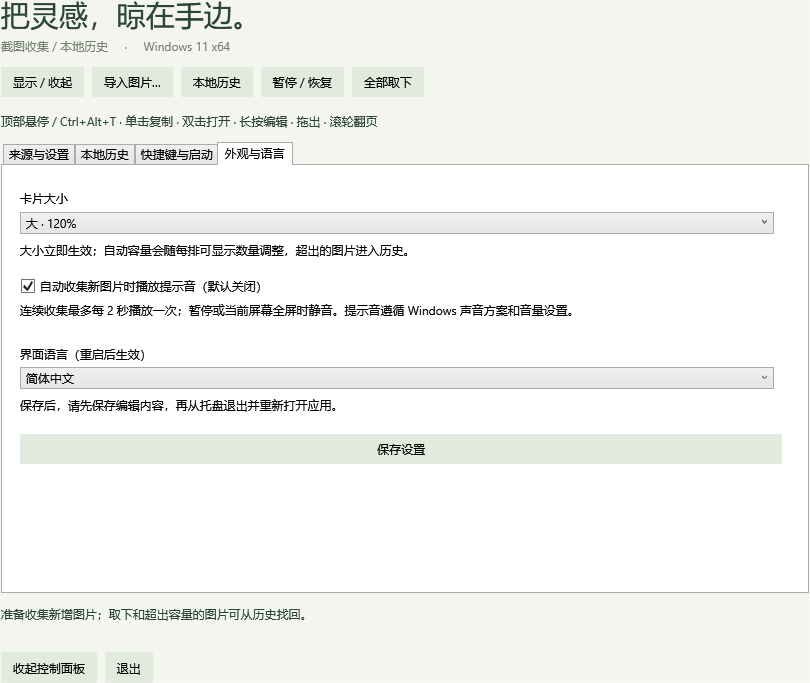
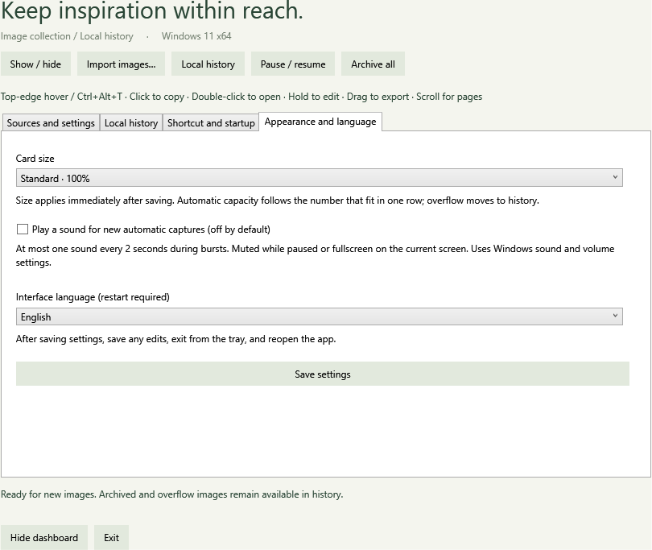
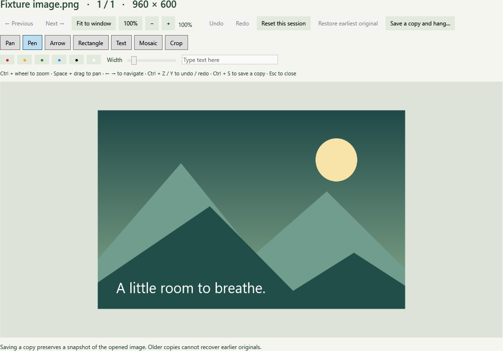

# 阶段 2 第三批：大小、提示音与中英文

日期：2026-10-22。v0.4.0，基于已合并的 PR #4（`dac5d20569706bd93d0c0f5594c55aff11665efe`）。独立实现，没有引入第三方包或参考其他 Windows 移植项目。

## 已实现

- 控制面板和托盘新增“外观与语言”。卡片提供小 80%、标准 100%、大 120%，保存后立即生效；内部布局整体缩放，缩略图、夹子、文字和取下按钮保持相对位置。尺寸与显示器 DPI 分别计算，窄小工作区进一步缩小以容纳完整卡片。
- 自动容量按当前尺寸的一排数量计算，增大卡片后溢出进入历史，原文件保留。25/50/100 的固定容量不随尺寸改变，仍使用滚轮分页。交互进行中暂不允许修改大小。
- 提示音默认关闭，仅自动目录收集和剪贴板成功提交新图片后触发 Windows 提示音。两秒限频，不延后补播。首次基线、去重、失败写入、原图快照、手动导入、历史恢复均不触发；暂停或鼠标所在屏幕全屏时静音。
- 简体中文和英文覆盖控制面板、托盘、卡片菜单、历史、编辑工作台及应用自身错误文案。语言保存在现有配置中，重启生效；保存后持续显示重启提示，当前编辑窗口保留。
- 设置的目录/大小/语言输入框，以及编辑器的缩放、颜色、粗细和标注输入补充了无障碍名称。减少动画开关继续控制浮层淡入。文件名、用户标注及图片内容不翻译。

## 验证

Windows 11 23H2 x64，.NET SDK 10.0.402 / runtime 10.0.13；两台显示器均为 150%，副屏有负 Y 坐标。没有实测混合 DPI，也没有使用真实系统剪贴板或修改真实登录启动项。

共 278 项检查：Core 92、Storage 74、桌面 19、Library 20、Editor 34、Preferences 16、Appearance 23。

- Core：三档尺寸 × 五档 DPI，负坐标、窗口间隙和极小工作区；自动容量变化；静音、限频、暂停和全屏声音策略；翻译键覆盖、格式参数与英文资源完整性。
- Storage：旧配置补齐标准大小/静音/中文默认值，新字段重启恢复，非法设置保留原配置；100 文件突发收集的通知事件；重复、失败、手动导入和快照不通知。
- Appearance：实际 WPF 卡片三档物理边界、取下按钮位于窗口内、NOACTIVATE 保留；大小导致溢出时文件与记录保留；固定容量不变；中文/英文页面自身渲染；工作台无障碍名称；通过设置按钮保存并验证语言重启提示。
- 既有 Library、Editor、Preferences 回归覆盖文件生命周期、编辑恢复、配额、快捷键及登录设置回滚。

首次桌面运行有 4 项跨进程命中失败；增加实际命中窗口、进程与测试背景边界记录后复测 19 项全部通过，没有修改浮层穿透策略。首次失败根因未确认，桌面命中仍需人工复核，不以一次复测代表所有应用通过。诊断 CPU/显示耗时是单次采样，不作为性能验收通过依据。

证据位于 `docs/evidence/v0.4-*.json`；自身界面渲染来自 `--appearance-test`。诊断只使用生成夹具与隔离数据库，未调用真实提示音播放，声音输出效果须人工试听。

## 升级与边界

数据库仍为 schema v2；新增三个 JSON 设置字段，无额外数据迁移。从 v0.2.0 升级仍会执行 v0.3.0 的 v1 → v2 迁移和数据库备份，见[上一批升级说明](STAGE2_ORIGINALS_PREFERENCES.md)。本轮没有迁移正在运行的用户数据库。

保存编辑内容后，从旧版托盘退出，再打开新便携包。单实例机制会将重复启动转交已有进程，因此旧版未退出时不会切换到新版本。新包可在没有 .NET SDK 的机器运行，仍需干净 Windows 环境验收。

提示音遵循 Windows 声音方案、静音和音量设置；不保证用户禁用系统声音后仍能听见。全屏识别沿用窗口几何规则。历史里此前持久保存的错误文本可能沿用原语言，系统对话框和系统异常遵循 Windows/.NET 环境语言。

## 待人工核验

- [ ] 三档大小分别单击复制、双击打开、长按编辑、取下和拖出；拖出后原图和卡片保留。
- [ ] 自动容量下从小改大，溢出记录可在历史找回；固定容量下分页完整。
- [ ] 开启音效后截图，确认音量合适；连续截图、去重、暂停、全屏及关闭音效符合规则。
- [ ] 保存英文设置，保留当前编辑内容；主动保存并重启后检查托盘、菜单、历史、工作台；再切回中文。
- [ ] Narrator 朗读、Tab/Shift+Tab 焦点顺序、英文窄窗口布局、混合 DPI 切屏和显示器拔插。
- [ ] 浏览器标签栏、资源管理器及其他应用上方的绳线/间隙/空提示穿透，隐藏后下方区域正常点击。

阶段 2 尚待动效完善与人工交互验收；录像和扩展格式仍属于阶段 3。
