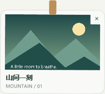

# 阶段 2 第四批：动效与交互收尾

日期：2026-10-22。v0.5.0，建立在 PR #5 的大小、提示音和中英文功能之上。本批独立开发和审查，PR #5 的人工验收仍保留，没有因此自动合并。

后续更新：v0.18.3 改为[整排准备、同时淡入](SHELF_ENTRANCE.md)，保留原有有限摆动与减少动画规则。

## 可体验的变化

- 卡片出现时短暂淡入、缩放并轻微摆动，约 620 ms 内停稳；没有持续循环动画。鼠标进入、按下或打开菜单时立即停止，便于点按、长按和拖拽。
- 已展开的晾衣绳收到新图片时，新卡片有入场效果；已有卡片保持稳定。位置调整直接完成，不移动整个交互窗口来播放动画。
- 取下时先提交历史状态，再播放约 140 ms 的淡出缩小效果。退场窗口立即改为鼠标穿透，停止待执行的复制、长按和菜单操作，结束后关闭。原文件和已有副本不受动画影响。
- 快速连续更新时，退场窗口数量限制为一排容量。收起、全屏触发隐藏、显示器布局变化和退出会立即清理退场窗口；隐藏窗口停止所有动画。
- “减少动画”覆盖卡片入场、摆动、取下及绳线淡入，并遵循 Windows 的客户端动画开关。保存设置或收到系统动画设置变化时，会立即停止当前动画，关闭尚未完成的退场窗口。
- 编辑器粗细滑块获得焦点时，方向键留给滑块，不再被左右切图截走；文字输入框的方向键继续用于移动光标。
- 缩略图自适应标签占用后的剩余高度，防止卡片底部说明文字被裁切。

## 验证与证据

本机为 Windows 11 23H2 x64，两台显示器均为 150% DPI。自动化使用生成图片、隔离数据库和独立的测试背景进程，没有操作其他应用的控件、发送系统键鼠输入、修改真实剪贴板或登录启动项。

累计 311 项检查：Core 92、Storage 74、Desktop 19、Library 20、Editor 34、Preferences 16、Appearance 26、Motion 30。对应结果保存为 `docs/evidence/v0.5-*.json`。

动效检查覆盖：实际动画时钟启动与释放、摆动边界、前台焦点不变、鼠标进入后停稳、仍不透明时立即穿透、淡出后关闭、入场/退场交替、不播放动画时立即关闭、快速列表更新、控制器释放、历史先提交与源文件保留、写入历史失败时保留可交互卡片、最后一张取下时空提示，以及滑块和文本方向键。

外观检查新增三档尺寸下完整标签的边界验证。系统动画关闭使用注入的只读策略进行分支测试，没有改写用户的 Windows 设置；真实系统开关变更仍列入人工验收。

此前的命中检查偶发落到 Edge 窗口而非预期的测试背景。本轮为背景增加 WPF `Topmost=true`，并等待有内容的窗口首帧绘制后才发出握手，避免只通过原生位置调用设置置顶及过早开始测试；保留实际命中进程、窗口和背景样式作为证据。这是测试夹具修正，不以复测结果代替所有应用的人工穿透验收。

## 待人工核验

- [ ] 从旧版托盘退出后启动 v0.5.0；有未保存编辑时先保存。确认没有重复启动旧实例。
- [ ] 新截图入场并短暂摆动后停稳；鼠标快速移入时立即停稳，单击、双击、长按和拖拽不误触。
- [ ] 小 / 标准 / 大三档分别验证复制、默认应用打开和拖出；拖出后原图、卡片均保留。
- [ ] 单张、左右侧和全部取下都进入历史；取下最后一张时显示“暂时没有图片”。淡出期间及收起后可操作下方应用。
- [ ] 中途开启“减少动画”后立即停稳；再关闭开关，下一次显示或新增卡片恢复动效。Windows 动画开关也分别验证。
- [ ] 普通最大化、全屏视频/游戏分别验证；全屏隐藏后不残留半透明窗口。悬停、菜单和拖拽时的显示保持符合预期。
- [ ] 画笔粗细滑块用左右键调节，文字框用左右键移动光标，图片浏览仍可左右切图；检查 Tab / Shift+Tab 和 Narrator。
- [ ] 浏览器标签栏、资源管理器及其他应用上的绳线、间隙和空提示穿透；混合 DPI、负坐标、显示器拔插与主屏切换。
- [ ] 继续完成 PR #5 的提示音试听、语言重启切换和固定/自动容量验收。

阶段 2 的功能开发已覆盖计划范围，人工验收、混合 DPI 和性能目标尚未全部完成；这仍是开发版，不宣布阶段 2 正式验收通过。录像与扩展格式属于阶段 3，本轮没有开始。

## 实现参考

- [WPF 客户端动画设置](https://learn.microsoft.com/en-us/dotnet/api/system.windows.systemparameters.clientareaanimation?view=windowsdesktop-10.0)
- [Win32 分层窗口及鼠标穿透](https://learn.microsoft.com/en-us/windows/win32/winmsg/window-features#layered-windows)
