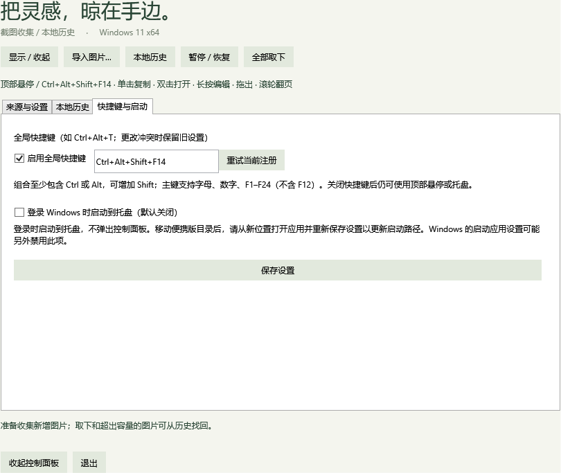
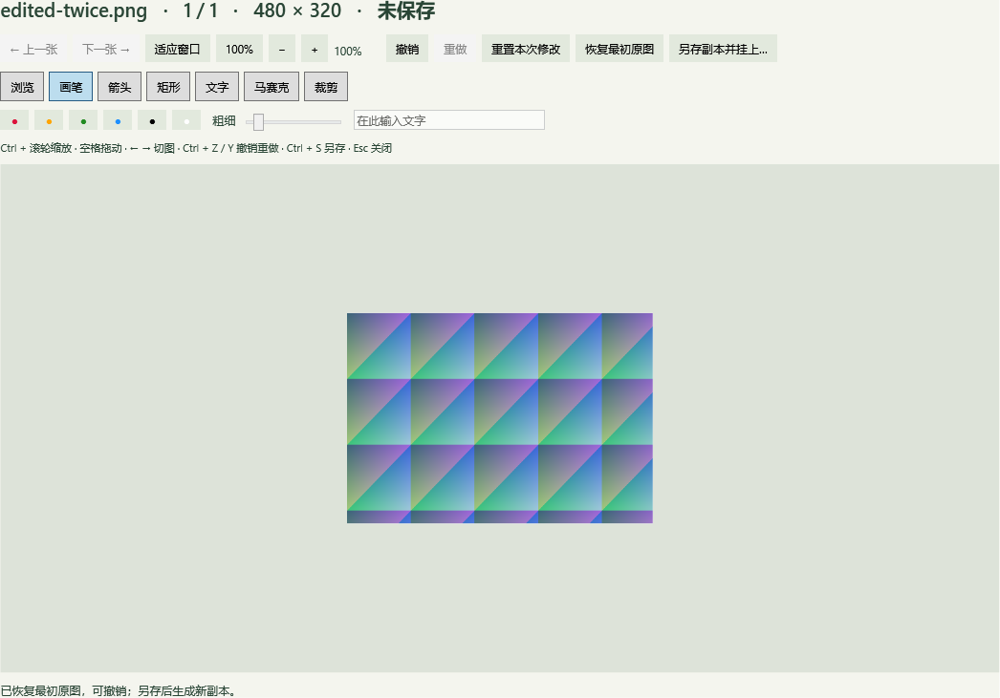

# 阶段 2 第二批：原图恢复与桌面设置

日期：2026-10-22。v0.3.0，基于已合并的 PR #3 继续开发。此版本没有新增第三方包，也没有参考其他 Windows 移植实现。阶段 2 尚有大小/音效、英文、无障碍及动效待完成。

## 可体验的变化

- “另存副本并挂上”先保留当前图片的最初原图快照，再保存外部 PNG 并建立关联。后续编辑这个副本会复用最初快照；重启后点“恢复最初原图”可恢复完整画面，再次另存新副本。恢复本身可撤销，原文件与已有副本均不覆盖。
- “重置本次修改”仍恢复当前窗口打开时的图片，和“恢复最初原图”具有不同含义。逐步撤销栈和标注层没有持久化；保存的是 PNG 文件及原图关联。
- “快捷键与启动”独立页支持修改/关闭全局快捷键、重试注册，以及默认关闭的登录启动。登录启动仅在主动保存设置时更新本应用的当前用户启动项；正常启动和暂停收集不会重建被移除的启动项。
- 新快捷键先尝试注册，旧快捷键一直保留至设置保存成功。注册冲突、数据库保存失败或启动项写入失败会回滚；若系统拒绝回滚启动项，会明确提示去 Windows 设置检查。
- `--startup` 启动到托盘，不主动打开控制面板；已有实例存在时也不唤起面板。启动路径有空格时使用引号；便携版移动后需从新位置启动并保存设置更新路径。

## 原图生命周期与升级

SQLite 从 v1 事务升级到 v2，新增副本与原图的关联表，外键约束防止删除仍被依赖的原图记录。升级前通过 SQLite 备份 API 创建 `library-v1-backup-*.db`，包含 WAL 中已提交的记录。已有条目和设置保留，新增设置默认 Ctrl+Alt+T、不开启登录启动。

先保存未完成编辑并退出旧版，再运行 v0.3.0。旧版不能打开 v2 库；备份只含数据库，不含图片。需要保留完整回退环境时，应同时备份整个 Library 目录，而不是将 v1 数据库直接覆盖到正在使用的 v2 库上。本轮开发与自动化均使用隔离测试库，没有直接迁移用户正在使用的数据库。

原图快照是 Images 目录中的自管 PNG，带独立历史记录，标记为“编辑原版快照”，占用现有 512 MiB / 1 GiB / 2 GiB 配额。它不占晾衣绳位置；存在关联副本记录时，不受期限清理或显式回收影响。最后一条关联副本记录被移除后，重新计算快照的保留期限；仍在工作台使用时继续暂缓清理。永久保留设置继续有效。

创建快照使用 Pending 记录、`.part`、刷新和原子重命名。若后续副本导出失败，快照作为可见历史保留，可主动回收或按期限处理；不会留下没有数据库记录的隐藏副本。若文件已导出但挂上或关联失败，提示文件路径和原版快照位置，不删除成功保存的文件。

外部源图被移动后，已建立关联的副本仍能恢复快照；外部副本被其他程序改写时，像素哈希不匹配则开启新的原图关联，避免错误地恢复无关图片。快照缺失或内容改变时，拒绝恢复并保留工作台当前修改。旧版已导出的图片没有可追溯关联，不能推断更早原图。

## 自动化验证

Release 构建 0 警告、0 错误；**201 项检查通过**：49 Core、63 Storage、19 桌面、20 图片库、34 编辑、16 桌面设置。完整套件通过后，针对设置页布局和启动路径校验的调整重新构建，并通过全部编辑与设置诊断。

- Core：快捷键解析、规范化、功能键映射、拒绝重复修饰键/裸按键/Win 组合/F12，以及已有窗口和拖拽规则。
- Storage：v1 备份/升级、默认设置、重启持久化、快照写入/配额、多个副本共享原图、关联期间保护、最后引用释放后重新计时、回收失败保留。
- 编辑：实际 PNG 保存与关联、再次编辑和重启后恢复、外部源图被移走、裁剪区域找回、撤销/重做、会话重置、快照缺失/改变和导出失败。
- 设置：真实 Win32 快捷键注册与冲突，候选快捷键回滚，数据库和注册表失败分支；隔离 HKCU 测试键验证只移除本应用值，真实 Run 启动项保持不变。
- 既有空绳提示、只复制拖出、图片收集与历史回归通过。原生拖拽仍使用接收端回调，不代替真实鼠标目标矩阵。

证据位于 `docs/evidence/v0.3-*.json`；图像是生成夹具和本程序自身窗口渲染，不包含用户截图。环境：Windows 11 23H2 x64 / build 22631，SDK 10.0.402，运行时 10.0.13，两屏均 150%，含负 Y 坐标；混合 DPI 未实测。

## 待人工核验

| 操作 | 预期 |
|---|---|
| 编辑并裁剪后保存，退出应用、再次打开副本 | “恢复最初原图”找回完整画面，可再另存；已有文件不覆盖 |
| 在副本上继续编辑、保存为第二份副本 | 第二份仍恢复到最初原图，不多建相同链路快照 |
| 移走外部原图；另外改写一份外部副本 | 已关联副本可恢复快照；被改写副本不使用旧关联 |
| 尝试回收仍被副本依赖的原图快照 | 提示先移除关联副本记录，不删除文件 |
| 修改为可用快捷键、冲突组合、关闭、重启 | 成功的设置持久化；冲突保留旧组合；关闭后不拦截输入 |
| 开启登录启动，退出登录再登录 | 仅启动一个托盘实例，不弹控制面板；关闭启动后不再登录启动 |
| 移动便携版目录后从新路径运行并保存设置 | 下次登录使用新路径；旧路径不可用时有明确反馈 |
| Windows 启动应用页禁用启动项后运行本应用 | 不修改 StartupApproved，不主动绕过系统禁用 |
| 使用旧版真实数据的副本升级 | 记录、设置和图片保留，生成 v1 数据库备份 |

真实登录/重启、Windows 策略限制、桌面快捷键实际按键、鼠标手势、保存对话框、混合 DPI、大图性能仍待人工验收。临时注册表键与键位测试没有启用用户的登录启动，也没有模拟真实用户输入。

## 官方接口依据

快捷键通过 [RegisterHotKey](https://learn.microsoft.com/en-us/windows/win32/api/winuser/nf-winuser-registerhotkey) 注册，排除系统保留的 Win 组合和 F12。登录启动使用 [当前用户 Run 项](https://learn.microsoft.com/en-us/windows/win32/setupapi/run-and-runonce-registry-keys)，限制命令长度，不修改系统的 StartupApproved 状态。
