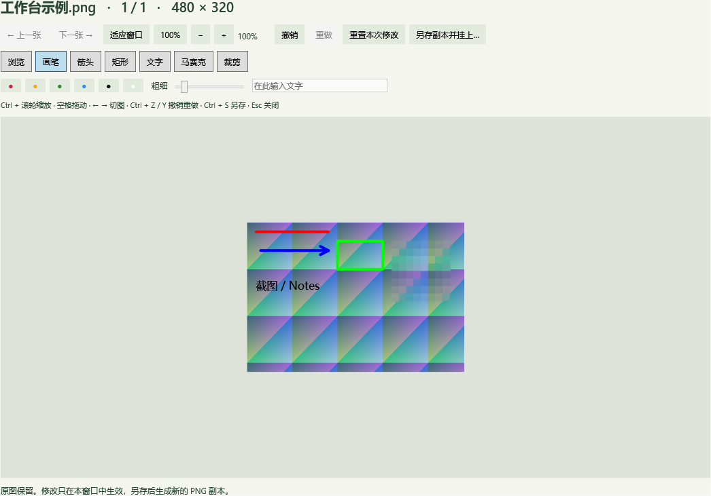

# 阶段 2 首批：图片工作台

日期：2026-10-22。版本 v0.2.0，Windows 11 x64，.NET 10 / WPF。这是阶段 2 的首批增量，阶段 0/1 的人工验收待办继续保留。本次没有新增第三方依赖，也未读取现有 Windows 迁移版本。

本报告保留 v0.2.0 的验收范围；后续原图恢复、快捷键和登录启动进展见 [v0.3.0 验证报告](STAGE2_ORIGINALS_PREFERENCES.md)。

## 已实现的行为

- 卡片右键预览或编辑；长按约 650 ms 编辑。达到拖拽距离后取消长按，双击仍由默认应用打开，短点击仍复制。拖出继续使用 COPY，保留原图和卡片。
- 工作台读取当前晾衣绳或历史的有效图片清单；左右切换、适应窗口、100%、1%–800% 缩放、平移及键盘快捷键。清单是打开时的快照，后台新增图片不会改变当前切图顺序；源文件失效时显示错误。
- 画笔、箭头、矩形、文字、马赛克和矩形裁剪；标注按原图像素坐标保存，会话内最多撤销 100 步。马赛克从原图区域计算均色方块并覆盖标注。裁剪、重置也可撤销。
- PNG 另存副本并挂上。使用临时文件、刷新、同目录重命名与冲突编号，不覆盖已存在文件。主动保存的副本不被跨来源短时去重丢弃，同路径重复事件仍合并。
- 未保存修改在关闭、切图和应用退出时提示。保存失败保留窗口内容；文件保存成功但挂上失败时给出文件路径，可手动导入。文件操作期间禁止关闭编辑窗口。
- 工作台对当前文件持有引用计数保护；历史到期清理跳过使用中的文件和记录，关闭最后一个相关窗口后按原期限清理。工作台打开时拒绝应用内显式回收，避免中途移除源文件。
- 左右侧取下按完整的新到旧排列计算，跨分页、排除当前卡片；全部取下包括当前卡片。SQLite 事务批量改为历史，取下操作不删除任何原文件。

## 验证范围

Release 构建通过，0 警告、0 错误。**147 项检查通过**：38 Core、47 Storage、19 桌面、20 图片库、23 编辑诊断。完整套件通过后，针对新增的物理像素缩放修正重新构建并通过全部编辑诊断。编辑诊断的重复运行还覆盖同名编号输出，避免将编号文件误判为格式不符。

结果归档至 `docs/evidence/stage2-editor-diagnostics.json`、`stage2-desktop-diagnostics.json`、`stage2-library-diagnostics.json`。工作台示例由本程序自身渲染，使用生成图片，不采集桌面或用户截图。

本机 Windows 11 23H2 / build 22631，SDK 10.0.402、运行时 10.0.13，两台显示器均 150%，其中一台具有负 Y 坐标。当前验证包含单个显示器 DPI 下 100% 显示对应物理像素；不代表混合 DPI 矩阵通过。桌面诊断中快捷键首次注册被占用，已验证冲突提示分支；真实快捷键操作仍按人工清单核验。

- Core：跨页左右范围、锚点保留、边界和失效锚点，兼顾已有窗口/拖拽规则。
- Storage：批量取下、重复操作保留原期限；活跃编辑文件暂缓清理、释放后恢复清理；显式编辑副本去重规则；此前收集与恢复回归。
- 编辑诊断：非 96 DPI 原图的像素定位；各标注、马赛克、裁剪及多次裁剪；撤销/重做/重置/脏状态；原始位图与文件不变；同名导出、PNG 格式；工作台读取与多窗口文件保护。
- 原桌面和库诊断继续覆盖空晾衣绳提示、窗口命中、原生文件交付和回收。原生拖拽诊断使用接收端回调替代真实鼠标循环，不代表真实目标矩阵已完成。

## 待人工核验

| 操作 | 预期 |
|---|---|
| 短点击、双击、长按、按下后立即拖出 | 分别复制、默认打开、内置编辑、仅复制拖出；一次手势不重复触发 |
| 同盘 / 跨盘 / Shift 拖出、取消与拒收 | 原图和卡片保留，不因进入编辑阶段发生回归 |
| 每种标注分别绘制，缩放后绘制，连续裁剪 | 位置与指针一致，导出与预览一致，无 DPI 偏移 |
| 输入中文/英文文字，改变颜色与粗细 | 点击放置正确，输入框中的 Ctrl+Z 和方向键不切换图片 |
| 缩放、空格拖动、左右切图、窗口调大小 | 可以浏览完整图片；切图有边界，适应窗口不抖动 |
| 编辑后关闭 / 切图 / 托盘退出，分别选择保留或放弃 | 保留时留在窗口，放弃时完成操作，原图始终保留 |
| 保存到同名路径、取消保存、无写权限、磁盘满 | 不覆盖原文件；失败保留编辑，取消不丢修改 |
| 保存后检查新卡片、历史和再次启动 | 副本 PNG 可打开且保留；原图可能因容量进入历史，但不删除 |
| 多页的左侧 / 右侧 / 全部取下 | 跨页范围正确，左右保留锚点；历史可找回，空绳仍显示提示 |
| 100% / 150% / 200% 混合 DPI，多屏移动工作台 | 窗口、标注坐标及鼠标命中一致 |
| 4000 万像素附近大图、多个工作台 | 记录解码/渲染/保存延迟与内存峰值，评估是否需要更低上限 |

## 当前限制与后续

- “重置本次修改”只恢复窗口打开时的图片；导出副本不会持久化标注层、撤销栈或原图关联。重新打开副本后不能恢复上一会话内容，这部分原版恢复需求尚未完成。
- 导出的副本属于外部引用，依赖保存路径。副本增加后仍执行容量规则；到期只移除其历史记录，不自动删除外部 PNG。
- GIF/TIFF 等只编辑首帧；导出为静态、96 DPI PNG，不保留原始元数据。马赛克是视觉标注，不保证无法推断敏感内容。
- 解码和 PNG 编码在后台执行，WPF 合成导出和马赛克计算目前在 UI 线程，接近像素上限时可能短暂阻塞；大图性能尚未正式验收。
- 自定义全局快捷键、登录启动、大小/音效设置、英文、完整无障碍与动效仍待阶段 2 后续提交。
- 本次自身窗口渲染与诊断无法替代真实鼠标手势、保存对话框和混合 DPI 人工验收。
