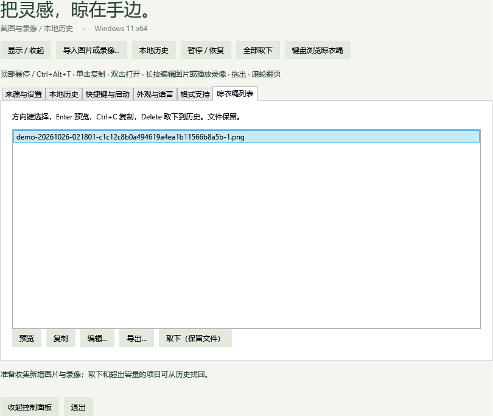
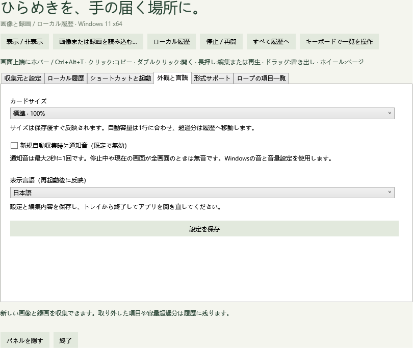

# 阶段 3 第四批：兼容性、稳定性与交互语言

2026-10-26，v0.9.0 开发版，基于已合并的 PR #1–#9。未读取或复用现有 Windows 移植项目。本批完成代码补强、可执行诊断及验收矩阵；**完整兼容性验收尚未结束**，下方真实环境项目仍开放。

## 交付行为

### 桌面环境恢复

锁屏、挂起、远程或控制台断开时收起浮层并阻止重新展开。挂起、锁定、断开分别记状态，唤醒不能错误解除锁屏限制。恢复后刷新显示器位置、请求来源补扫并重试快捷键注册，不主动弹出旧卡片。普通控制面板与工作台在加载、DPI 或显示器变化后调整到当前工作区内。

虚拟桌面使用公开 `IVirtualDesktopManager` 查询及移动本应用窗口。显示前尝试跟随前台窗口所在桌面；检测到绳线不在当前桌面时收起。接口不可用时保守降级，不调用未公开 Shell 接口，不切换或固定用户桌面。查询接口通过不代表实际切换场景已经通过。

### 图片处理与资源边界

- 原始图片的 WPF/WIC 解码移到最多两个复用子进程。主进程仅接收并校验尺寸、DPI、哈希字段和 BGRA 像素文件长度；仍限制 64 MiB、4000 万像素。
- 每个任务限时 20 秒，轮询私有内存超过 768 MiB 时终止相应子进程。取消也终止该任务进程；原文件保留，后续任务可启动新进程。内存检测是轮询保护，不是操作系统硬配额；进程隔离不是权限沙箱。
- 工作进程每 64 个任务回收，空闲约 60 秒退出；任务自身有 30 秒退出保护，减少父进程异常退出后的遗留。临时清理只处理应用命名目录中的已知文件，不递归、不跟随目录重解析点、不删除未知文件。
- 缩略图后台加载，缓存最多 64 项，最大边 420 像素（该缓存像素上界约 44 MiB）；完整原图不保留在缩略图缓存。整进程内存还包括窗口、当前卡片、编辑图像和系统组件，不能把缓存上界当作整应用上界。
- 普通图片最多两个收集任务并行，解码不再持有提交锁，异常慢图片不会阻止剪贴板提交。UI 刷新使用占位缩略图；复制中的解码和 PNG 编码、马赛克计算和编辑输出渲染转为异步。
- Windows 剪贴板提供的图像、应用生成的预览及录像处理继续使用各自路径；本批隔离的是原始图片文件解码，不能推导为所有媒体操作都进入了同一种隔离。

### 键盘与语言

“键盘浏览晾衣绳”打开主动聚焦列表：方向键选择，Enter 预览，Ctrl+C 复制，Delete 取下到历史，Tab 到达编辑、导出等按钮。取下保留文件。图片工作台中 Alt+C 聚焦画布，方向键按原图像素移动光标，Shift 每次 20 像素；选工具后 Enter 设置起点及完成标注，文字工具 Enter 放置已输入文字，Esc 取消当前标注，再按关闭窗口。撤销重做沿用 Ctrl+Z/Y。

列表暴露选择模式，画布提供可聚焦且有名称的 AutomationPeer，状态使用节流的 polite live region。自动检查只验证控件与事件结构，不能证明 Narrator 实际朗读质量。

语言包含简体中文、英语、西班牙语、法语、加利西亚语、巴西葡萄牙语、日语、韩语、土耳其语、阿塞拜疆语、印地语。中文为源字符串，其余 10 个资源各 339 项；检查非空、参数及文件过滤器，保存后重启生效。语言范围来自原版 macOS 基线目录，译文独立编写；尚未完成母语校对。文件名、用户内容与系统组件产生的错误信息保留原样。

本机还检查了[法语界面](images/stage3-language-fr.png)和[印地语界面](images/stage3-language-hi.png)的渲染；主要控件未见重叠或缺失。

## 本机验收矩阵

环境：Windows 11 23H2 x64，系统构建 22631，.NET 10.0.13。两块真实显示器：2560×1600，原点 (0,0)；3840×2160，原点 (2560,-223)；**两块均为 150% 缩放**。

| 项目 | 验证方式与状态 | 仍缺证据 |
|---|---|---|
| 两屏定位、负坐标、三档卡片 | 原生窗口矩形与预期物理像素比较，隐藏后命中面消失 | 不同真实 DPI、改变主屏和物理拔插 |
| 100%–200% 坐标规则 | 核心几何测试 | 不能替代真实混合 DPI |
| 不激活浮层、绳线穿透 | 本应用独立背景进程与实际 HWND 命中/前台比较 | 浏览器、Office、聊天应用等真实交互 |
| 无边框全屏、最大化、普通窗口 | 本应用独立背景进程，实际几何判断和全屏抑制 | 真正全屏视频、游戏和共享软件 |
| 锁屏、睡眠、断开及恢复 | 注入事件组合，检查阻止展示、重置、恢复通知 | 真实锁屏、睡眠/唤醒与 RDP |
| 虚拟桌面 | 公开 COM 接口实际查询，当前桌面跟随调用 | 实际跨桌面切换与多屏组合 |
| 异常图片处理 | 真实工作进程路径注入挂起、退出、取消及内存阈值，随后正常解码 | 不同机器/系统解码器的异常变体 |
| 键盘与无障碍结构 | 列表选中、取下、画布标注/裁剪与撤销、控件名称和 live region | 实际 Tab 顺序、Narrator 听读 |
| 11 种语言 | 资源检查、设置持久化和窗口渲染 | 母语自然度、极小工作区与全部对话框 |
| 文件安全、图片和录像闭环 | 既有 Core/Storage/桌面/媒体回归 | 真实跨应用拖放、HEIC 色彩方向、录像音画同步 |

## 自动化与性能记录

运行 `./scripts/test.ps1 -Desktop -Soak`。测试使用生成素材、隔离数据库和本程序专用窗口；不读取个人截图，不发送真实键盘/鼠标输入，不更改显示配置、不锁屏或切换桌面。

Release 构建 0 警告、0 错误。完整回归通过 567 项：Core 148、Storage 91、Desktop 20、Library 20、Editor 34、Preferences 16、Appearance 26、Motion 30、Video 30、Video trim 24、Image format 33、Compatibility 87、Performance 4、Soak 4。随后修正性能报告在偶数样本下的中位数算法，重新构建并单独复跑性能采样；下表采用该复测结果。证据见 [汇总](evidence/v0.9-summary.json)、[兼容性](evidence/v0.9-compatibility.json)、[性能](evidence/v0.9-performance.json)与[循环稳定性](evidence/v0.9-soak.json)，其余分组在 `docs/evidence/v0.9-*.json`。

| 测量 | 本机结果 | 解读 |
|---|---|---|
| 隐藏 CPU，含一个图片工作进程 | 30 秒平均 0.052%，按一个逻辑核心 | 此采样低于 0.5% 初始目标；不代表任何负载下都满足 |
| 隐藏资源，含工作进程 | 工作集 151.1 MiB，私有内存 73.9 MiB | 预热后小型隔离库，不代表大量编辑窗口 |
| 10 张 1080p PNG 写入关闭→记录和卡片就绪 | 中位数 426.9 ms，最近秩 P95/最大值 548.3 ms；9/10 在 500 ms 内 | 约 500 ms 目标仍有尾延迟；冷启动与高负载待跟踪，不标记为所有样本硬达标 |
| 100 张小图片突发 | 9.63 秒；110 条总记录、100 张卡片、10 条历史 | 包含前面的 10 张延迟样本，无漏项或重复 |
| 1200 万像素马赛克及后台渲染 | 396.4 ms，UI 定时器推进 12 次 | 证明期间 UI 消息泵仍运行；不是实际输入延迟测试 |
| 60 轮恢复/取下 | 123.3 秒；窗口数每轮回落；文件/记录完整 | 私有内存每 10 轮采样约 69.1→79.1→77.8→78.3→77.5→77.0 MiB，未见持续增长 |

首次同日性能采样 10/10 在 500 ms 内（最大 469.4 ms）；复测出现 548.3 ms 的一次尾延迟，因此不以首次较好数字宣称稳定达标。性能组的 4 项通过检查针对隐藏、无丢失、缓存上限及后台响应，不把 CPU/延迟观测值伪装成已经通过的长期性能承诺。

性能测量分别报告：启动预热 10 秒后的 30 秒隐藏 CPU（包括图片工作进程，按一个逻辑核心计量）、10 张生成的 1920×1080 PNG 从写入关闭到记录和卡片就绪、100 张小图片突发、1200 万像素马赛克及渲染。捕获延迟不包含最终屏幕扫描显示，也不包含首次冷启动解码器；进程空闲退出后的首次处理可能更慢。不能用一次本机均值承诺所有图片或机器都在 500 ms 内完成。

持续循环诊断对隔离库执行 60 次“10 张恢复→全部取下”，每轮间隔 2 秒，检查卡片窗口数量回落、文件/记录保留、缓存有界和内存趋势。这是约两分钟的循环回归，不是通宵或数日运行的可靠性证明。

本批保留两份早期失败证据：`v0.9-desktop-first-failure.json` 的前台窗口变化，以及 `v0.9-compatibility-first-failure.json` 的全屏夹具失败。前者原始记录不足以判断是谁改变了前台窗口，现已加入稳定背景起点、前后 HWND/PID 记录；后者的无边框夹具此前仍可调整大小，现改为不可调整大小的真正全屏窗口并记录窗口矩形。后续通过不抹掉失败记录，也不据此宣称真实应用焦点兼容性问题全部解决。

便携包完整兼容性诊断出现两次等待测试窗口取得前台焦点超时；尝试显式授予测试子进程前台权限亦被拒绝，未将该尝试加入产品。完整便携包前台验收仍开放，失败记录保留为 `v0.9-packaged-compatibility-first-failure.json` 和 `v0.9-packaged-compatibility-retry-failure.json`。新增显式 `--compatibility-functional-test` 入口，只运行其余 83 项，并在 JSON 中标记 `functional-only-foreground-excluded` 及未验收前台项目；它不能替代 `--compatibility-test`。标准 `test.ps1 -Desktop` 仍运行完整模式，不会静默跳过失败项。超时错误补充窗口/PID 便于后续定位。

## 待人工核验清单

使用本次便携包，先保存编辑并退出旧版。为每项记录 Windows 构建、软件版本、屏幕配置、结果及复现步骤；失败项保持开放。

- [ ] **真实混合 DPI**：分别在 100%/150%/200% 屏幕展开、复制、编辑和收起；切换主屏、插拔副屏、调整显示器相对位置。预期卡片不越界，隐藏后无残留点击区域，工作台仍可操作。
- [ ] **焦点与穿透**：在浏览器、记事本、资源管理器中持续输入，悬停或快捷键展开；点击绳线和卡片间隙。预期输入仍到原窗口，只有卡片本身处理操作；记录任何抢焦点的时机。
- [ ] **真实全屏**：浏览器视频全屏、无边框游戏与普通最大化分别测试。开启全屏抑制后，真正全屏不自动展示或发声；退出全屏可正常呼出，普通最大化不被误判。
- [ ] **虚拟桌面**：在桌面 A 显示，切到 B；从 B 呼出浮层、控制面板及工作台，再返回 A。预期不强制切换用户桌面，不出现旧桌面的卡片残影或无法唤起的面板。
- [ ] **锁屏与睡眠**：有图/空绳两种状态下锁屏和睡眠，恢复后新增截图并呼出。预期无意外弹出、无重复挂图，快捷键和目录收集继续工作。
- [ ] **远程与共享**：RDP 连接、断开重连后检查窗口位置/快捷键；在实际使用的会议软件中分别共享窗口和屏幕。预期应用不异常遮挡控制区，展示内容符合用户选择；本应用不承诺从屏幕共享中隐藏截图。
- [ ] **拖出矩阵**：资源管理器同盘/跨盘、浏览器上传框、Office、实际聊天软件各测试复制、拖出、Shift 拖出及取消。预期成功只产生副本，原文件和卡片保留；目标拒收时有明确结果，不能变成移动原文件。
- [ ] **纯键盘与读屏**：Tab 进入晾衣绳列表，方向键/Enter/Ctrl+C/Delete，编辑器 Alt+C/方向键/Enter/Ctrl+Z，Esc 退出；打开 Narrator 听读标签、选中项、状态，确认不连续刷屏。
- [ ] **语言**：11 种语言分别保存重启，检查设置、历史、编辑、视频、错误与保存对话框；母语使用者核对用词、截断和参数。简体中文空绳须保持“暂时没有图片”。
- [ ] **真实媒体**：手机 HEIC 的方向/ICC/HDR、透明和动画 WebP、带声音的真实录屏及裁剪音画同步；缺少组件的干净机器验证提示与恢复。失败保留原文件，普通 PNG 可继续使用。
- [ ] **长时间运行**：日常工作至少 8 小时，混合截图、历史恢复、编辑、录像和休眠；记录初始/结束内存、CPU、漏项和失效窗口。当前两分钟循环不替代此项。
- [ ] **干净系统**：在另一台目标 Windows 11 x64、无 SDK/.NET 开发工具的环境运行便携包；验证升级旧库、关闭/再次启动以及登录启动。正式支持范围由这些结果决定。

## 官方接口依据

- [IVirtualDesktopManager](https://learn.microsoft.com/en-us/windows/win32/api/shobjidl_core/nn-shobjidl_core-ivirtualdesktopmanager)：查询窗口所属桌面、当前桌面状态及移动窗口；官方建议避免由应用主动切换用户桌面。
- [SystemEvents.SessionSwitch](https://learn.microsoft.com/en-us/dotnet/api/microsoft.win32.systemevents.sessionswitch?view=windowsdesktop-10.0) 与 [PowerModeChanged](https://learn.microsoft.com/en-us/dotnet/api/microsoft.win32.systemevents.powermodechanged?view=windowsdesktop-10.0)：消息泵接收事件，销毁时解除静态事件订阅。

本批没有增加运行时第三方依赖。安装器、代码签名、正式许可证选择和 GitHub Actions 权限配置属于后续发布工作。
