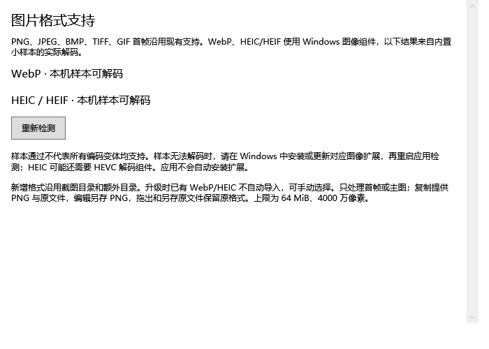
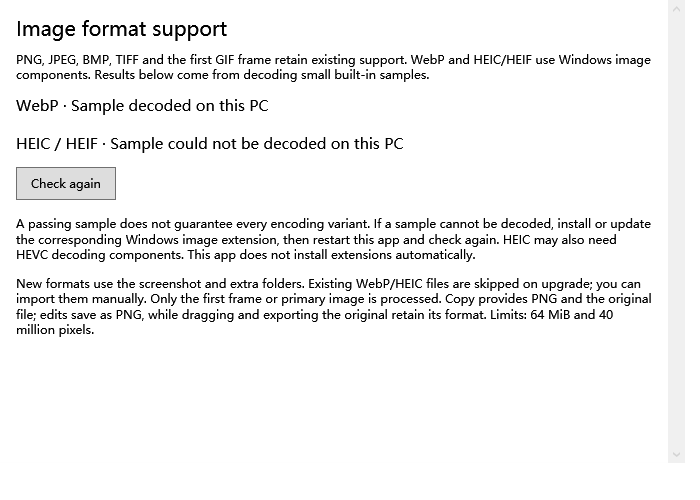

# 阶段 3 第三批：WebP 与 HEIC/HEIF

2026-10-23，v0.8.0 开发版。基于 PR #8 的录像裁剪分支，PR #8 尚未合并；本批另开分支与 PR。未参考现有 Windows 移植项目。

## 本批行为

- 图片来源与导入对话框增加 `.webp`、`.heic`、`.heif`，扩展名不区分大小写。使用已经安装的 Windows WIC 图像组件，不自动安装扩展，也不内置第三方解码器。
- 控制面板新增“格式支持”。首次显示时在后台解码内置 WebP 和 HEIC 小样本，实际检查尺寸和绿/蓝像素，不以扩展名、注册表或已安装包名宣称可用。支持重新检测。结果只代表该样本，不能覆盖所有编码变体。
- 缺少兼容组件或文件损坏时提示检查“格式支持”或先转换 PNG/JPEG，保留原文件。手动导入的最终汇总保留失败数量与前三个错误，避免立即覆盖具体原因；成功文件照常收集。
- 系统支持时，新增格式进入现有缩略图、复制、预览、编辑、拖出、取下、历史、原图像素快照与恢复流程。原格式导出复制字节并避开同名文件；编辑输出新 PNG。
- WebP 显式转换为 BGRA，修复原有 BitmapImage 路径丢失透明度的问题。动画 WebP 只处理首帧；HEIF 多图容器只处理解码器提供的第一帧或主图，不保留全部容器元数据。

## 升级与收集

已有截图/额外目录首次运行 v0.8 时，对扩展图片单独建立基线；目录中早已存在的 WebP/HEIC 不会突然全部挂上。之后新增或修改的文件会收集，旧文件可手动导入。监听仍不递归子目录。

可选格式在普通图片提交锁之外解码，独立串行任务不阻塞正常 PNG 和剪贴板提交；解码结束仍复核文件签名、暂停状态与当前来源，防止关闭来源后的迟到结果被提交。失败立即反馈，先以 30 秒、连续失败后 5 分钟间隔重试；原文件和未成功状态保留，可手动重试。

仍限制 64 MiB、4000 万像素；扩展图片的缩略图最大边 420 像素。SQLite 结构保持 v2，新增来源基线复用现有表，不迁移或清理用户图片。使用新增格式后建议继续使用 v0.8 或更新版本。

## 验证范围

Release 构建 0 警告、0 错误；本次完整回归一次通过 430 项：Core 107、Storage 91、Desktop 19、Library 20、Editor 34、Preferences 16、Appearance 26、Motion 30、Video 30、Video trim 24、Image format 33。证据见 `docs/evidence/v0.8-*.json`。本次桌面焦点检查通过，上一批偶发失败仍需真实应用人工复核。

专项命令：`Clothesline.exe --image-format-test artifacts/image-format-validation`，已纳入 `scripts/test.ps1 -Desktop`。测试只用生成的色块、透明块和两帧动画，不读取用户图片、不写真实系统剪贴板、不安装或卸载系统解码器。

本机的 WebP 与 HEIC 样本均通过实际解码。专项覆盖可用/不可用状态、不能只靠元数据通过检测、透明度与 PNG 复制、420 像素缩略图、像素/文件大小限制、动画首帧、HEIF 别名、目录到卡片、COPY 拖出、同名原格式导出、编辑 PNG 与原图快照、历史恢复、重开数据库及中英文界面。不可用状态使用注入的失败解码器模拟；真实缺少组件机器尚待核验。

核心/存储检查追加扩展名分类、升级基线、重复配置、后台慢解码时继续接收 PNG、关闭来源阻止迟到提交、失败不记录成功及 HEIF 手动导入。

图片解码沿用进程内 WPF/WIC，当前未像录像那样设置独立解码进程和硬超时；不能用正常/损坏样本测试证明异常系统解码器永不挂起。系统组件故障隔离、HDR/10-bit、ICC、旋转元数据、Live Photo 和多图 HEIF 仍需继续验证。

## 待人工核验

- [ ] 从旧版升级，原图片、录像、编辑原版关联与设置保留；旧目录里的 WebP/HEIC 不自动大量导入。
- [ ] 打开“格式支持”，检查本机结果；缺组件机器显示无法解码，安装/更新对应 Windows 扩展并重启后可重新检测。
- [ ] 真实透明 WebP、动画 WebP、手机 HEIC/HEIF：缩略图、颜色、透明度、方向和主图正确；动画只显示首帧符合预期。
- [ ] 复制到聊天/文档，拖出到同盘和跨盘目录，导出原格式后原文件与卡片保留。
- [ ] 编辑另存 PNG，关闭重启后仍能恢复最初原图像素；原格式文件字节不变。
- [ ] 损坏文件与不支持变体提示明确，最终导入汇总保留错误，正常 PNG 仍可加入。
- [ ] 中英文、键盘、Narrator、不同 DPI；并继续核验上一批的录像音画同步和窗口焦点。

## 官方参考与素材

- [Windows WIC 原生与扩展编解码器](https://learn.microsoft.com/en-us/windows/win32/wic/native-wic-codecs)
- [WPF 图像解码与扩展机制](https://learn.microsoft.com/en-us/dotnet/desktop/wpf/graphics-multimedia/imaging-overview)

样本来源与生成工具见 `src/Clothesline.App/Fixtures/README.md`。应用运行时没有新增第三方依赖，不需要 Python。
