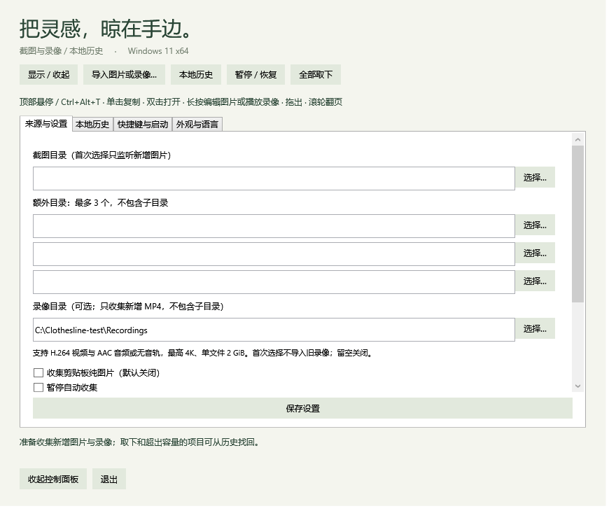

# 阶段 3 第一批：录像基础闭环

日期：2026-10-23。版本：v0.6.0 开发版。

## 已有版本的人工反馈

PR #5 与 #6 已合并。2026-10-23，用户对上一轮列出的 v0.5 关键验收项反馈“都正常”：快捷键与空提示、截图收集、拖出后保留原文件和卡片、历史与编辑恢复、动效与穿透、全屏和多屏体验、语言、提示音及快捷键设置。记录为用户本机关键流程验收通过。

该反馈没有逐项列出显示器缩放组合、应用名称、Narrator 路径或性能测量数值，因此不据此关闭完整兼容性矩阵或性能目标。自动化证据与用户人工反馈分别记录。

## 本批行为

- “来源与设置”增加一个可选录像目录，默认留空。非递归收集新增 MP4；首次配置跳过旧录像，同一个目录可以同时作为图片和录像来源。清空录像目录关闭监听，暂停和恢复沿用已有规则。手动导入支持图片与 MP4。
- 首批接受 H.264 视频、AAC 音频或无音轨的 MP4。单文件限制 2 GiB；画面尺寸限制 3840 × 2160，支持宽高交换的竖屏。不以 MP4 后缀判断编码是否支持。
- 录制文件稳定一秒且能以拒绝写入的共享方式打开后，进行元数据读取、内容哈希和缩略图解码。成功后作为 External 引用加入列表；原录像仍保留在原路径。
- 视频卡片显示播放标记和时长。单击复制录像文件，双击用默认应用打开，长按或右键“播放录像”打开内置预览。图片仍沿用原图复制和标注编辑。
- 预览初始暂停，支持播放、暂停、进度、音量、静音、Esc 关闭和默认应用入口。视频预览不显示图片标注工具；按 2026-10-26 确认的范围，视频编辑不属于项目功能。
- 拖出仅声明 COPY；取消、拒收或目标返回移动结果均不授权删除。复制和导出后卡片及源文件保留；同名导出自动编号，后台复制不冻结界面。
- 图片与录像共用容量和历史。取下、溢出或历史到期不会删除外部录像；回收仍通过明确的文件回收入口。打开的预览持有文件使用保护，关闭后释放。

## 失败与资源控制

每个录像探测使用独立隐藏子进程，串行执行；30 秒无结果即结束该子进程并报告错误。子进程自带 45 秒退出上限，避免主进程异常退出后持续运行。视频解析不持有图片/剪贴板提交锁，因此慢视频不阻塞新增截图。

未收集成功的文件保留在原路径，错误显示在状态区域；目录监听先以 30 秒间隔重试，连续失败后延长至 5 分钟。手动导入可主动重试。录制期间变化、文件占用、损坏或系统解码能力不足均不产生成功记录。预览打开超过 20 秒时显示失败及默认应用入口。

缩略图与元数据缓存在本地库 VideoCache，最多保留 128 份，每份缓存不超过 2 MiB；缓存按完整路径、大小与修改时间失效，启动后可复用。缓存不计入自管 PNG 的空间额度。不会为录像建立托管原文件副本。与既有图片签名策略一样，不能检测保持大小和修改时间不变的外部覆盖。

SQLite 表结构继续使用 v2，只在设置 JSON 增加 VideoFolder。旧配置默认关闭录像来源；已有图片、编辑原图关联和历史记录保留。v0.5 不能识别录像卡片，开始使用录像后不建议降级运行旧版。

## 验证

完整回归通过 351 项检查：Core 92、Storage 84、Desktop 19、Library 20、Editor 34、Preferences 16、Appearance 26、Motion 30、Video 30。Release 构建 0 警告、0 错误。

自动化使用 Windows 原生编码器生成纯色 H.264 视频，包括静默 AAC 音轨、无音轨和竖屏样本；不读取用户录像、不录屏、不写真实剪贴板，不操作外部应用控件。

录像专项覆盖实际解码缩略图颜色、编码与时长、缓存重启与文件替换、损坏文件、超时和取消、文件型剪贴板数据、COPY 拖出、目录首次基线与新增收集、导出重名、取下与恢复、内置播放进度/暂停/跳转、预览文件保护与到期清理、关闭资源释放。真实拖放目标、系统剪贴板粘贴和可听音轨仍需人工测试。

收集规则增加同目录双来源基线、重复事件、解析中关闭来源、慢解析期间继续收集图片、暂停恢复、非递归监听等检查。完整结果见 docs/evidence/v0.6-*.json。

运行 scripts/test.ps1 -Desktop；专项为 Clothesline.exe --video-test 后接隔离输出目录。诊断会短暂显示本程序的测试窗口。当前本机通过的结果不代表所有编码配置、4K 实录或 Windows N/缺失媒体组件环境均兼容。

## 待人工核验

- [ ] 退出旧版，启动 v0.6；原图片、设置、历史及编辑原图关联保留。
- [ ] 选择实际录像保存目录，保存设置；已有录像不自动挂上，新录制完成的 MP4 挂上。
- [ ] 播放实际 Windows 截图工具录像，验证画面、声音、暂停、进度、音量与关闭；另测较大文件、4K、竖屏及含旋转元数据的文件。
- [ ] 单击录像后粘贴到资源管理器或聊天软件；分别与图片复制行为比较。
- [ ] 拖到同盘、跨盘、上传框、Office/聊天目标；取消或拒收后录像与卡片保留。
- [ ] 取下、超容量进入历史；重新挂上、导出及明确回收符合预期。
- [ ] 录制进行中、损坏文件、无法解码的 MP4 均有反馈；新的图片仍能挂上。
- [ ] 中英文界面、Tab/Shift+Tab、进度和音量滑块的键盘操作。

## 实现与依赖参考

- [桌面应用调用 Windows Runtime](https://learn.microsoft.com/en-us/windows/apps/desktop/modernize/winrt-apis-desktop-apps)
- [MediaClip 与视频编码属性](https://learn.microsoft.com/en-us/uwp/api/windows.media.editing.mediaclip)
- [MediaComposition 缩略图](https://learn.microsoft.com/en-us/uwp/api/windows.media.editing.mediacomposition.getthumbnailasync)
- [音轨编码属性](https://learn.microsoft.com/en-us/uwp/api/windows.media.editing.embeddedaudiotrack)
- [WPF 媒体播放](https://learn.microsoft.com/en-us/dotnet/desktop/wpf/graphics-multimedia/multimedia-overview)

目标框架细化为 net10.0-windows10.0.19041.0 以调用系统媒体接口，产品首发仍面向 Windows 11 x64。随包新增 Windows SDK .NET 投影与 WinRT 运行时，具体版本和许可见 THIRD_PARTY_NOTICES.md。实现依据限于本项目需求与微软官方接口，没有参考现有 Windows 移植项目。
