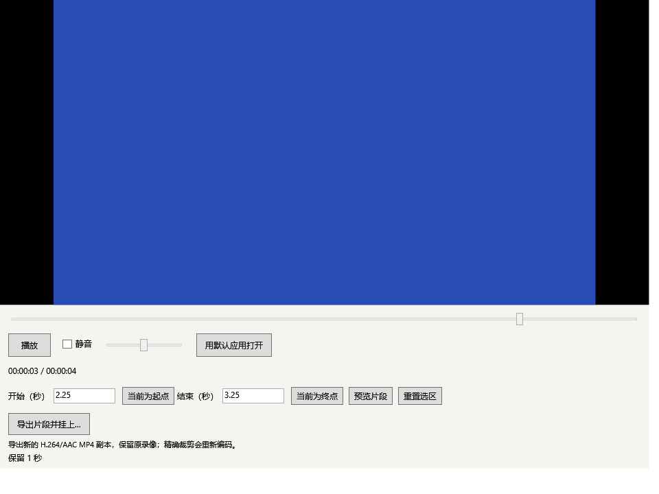
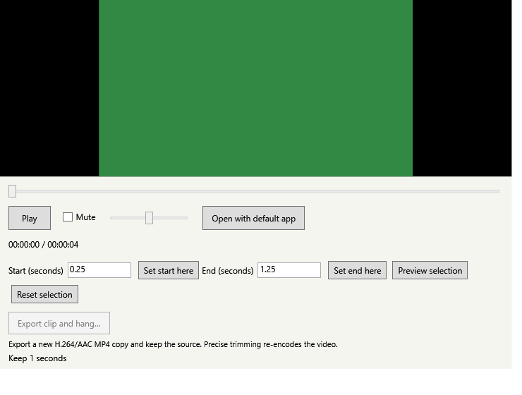

# 阶段 3 第二批：录像首尾裁剪

2026-10-23，v0.7.0 开发版。PR #7 已合并，录像目录收集、播放和共用历史作为本批基线。用户此前确认 v0.5 关键流程正常；这不代表 v0.6/v0.7 实际录像、音画同步或完整兼容性矩阵已获人工验收。

## 使用方式

1. 长按录像卡片，或右键“播放录像”，打开预览与裁剪窗口。
2. 输入开始与结束秒数，允许小数点；也可以跳转后点击“当前为起点/终点”。至少保留 0.1 秒。
3. 点击“预览片段”，从起点播放并停在终点。“重置选区”恢复整段。
4. 点击“导出片段并挂上…”，选择应用数据目录以外的保存位置。成功后新副本挂上，原文件和原卡片继续保留。同名文件自动追加编号，不覆盖。

导出中显示进度，可取消。关闭裁剪窗口会先取消导出，等待子进程结束和临时文件清理后关闭；从托盘退出时会提示正在进行文件操作。保存完成后的挂上步骤若失败，文件仍留在所选位置，可手动导入。

## 支持范围与输出规则

- 输入沿用 v0.6：MP4、H.264 视频、AAC 音频或无音轨，最多 2 GiB、3840 × 2160（允许宽高交换）。
- 使用 Windows 原生 MediaComposition 精确裁剪并重新编码，输出 H.264/AAC MP4。保留编码尺寸与帧率参数；目标视频码率参考源文件并限制在 0.5–40 Mbps。无音轨输入仍输出无音轨；有音轨时输出系统选定的一条 AAC 音轨。
- 不是无损剪切；音频采样率、声道、码率和容器元数据可能改变。不承诺保留多音轨、字幕、章节、HDR 或旋转元数据。缺少系统编码能力时反馈失败，不自动安装媒体扩展。
- 时间按秒指定，实际输出受帧和音频包边界影响。导出后重新解码，要求时长误差不超过 0.15 秒、尺寸不变、音轨数量符合规则；验证不通过时不提交副本。低帧率或特殊时间戳文件可能被拒绝。
- 当前预览用 250 ms 定时器停在选区末端，播放时可能短暂超过所选终点；导出使用精确裁剪接口，独立校验输出。
- 本批不新增数据库迁移、运行时依赖或用户媒体原版快照；裁剪结果作为外部引用，沿用现有容量与历史规则。

## 文件与进程保护

导出前验证源路径签名；独立隐藏子进程重新计算完整内容哈希，持有拒绝写入的文件句柄直至编码结束。即使外部覆盖保留大小和修改时间，也会拒绝与缓存内容不同的录像。窗口持有历史清理保护。

编码先写入目标文件夹内专属 `.clothesline-trim-*` 子目录，非递归目录监听不会收集半成品。完成后独立探测解码，检查取消标记，再以同卷、不覆盖的重命名提交。提交前取消或失败只清理本次任务已知的临时文件和空目录；从不递归删除目标目录。提交之后的取消不会删除已保存副本，仍尝试挂上。

主进程等待编码最多 30 分钟，超时或取消仅结束该任务自己的子进程。子进程另有 35 分钟生存上限。若应用被强制结束、断电或目标目录权限改变，可能留下专属临时子目录；不会扫描并自动删除这类残留，避免误删。原文件始终保留。

## 验证

Release 构建 0 警告、0 错误。最终回归通过 384 项检查：Core 101、Storage 84、Desktop 19、Library 20、Editor 34、Preferences 16、Appearance 26、Motion 30、Video 30、Video trim 24。桌面检查的首轮失败与复跑情况见下文。

专项命令：`Clothesline.exe --video-trim-test artifacts/video-trim-validation`，也已纳入 `scripts/test.ps1 -Desktop`。

使用原生编码器生成绿/蓝两段视频、静默 AAC 音轨和无音轨竖屏视频；不读取用户录像、不录屏、不写系统剪贴板。验证非关键帧裁剪、实际时长和首帧颜色、最短片段、尺寸/音轨、原字节保留、重名、取消前后提交语义、超时、缓存签名不变但内容替换、监听去重、工作台预览、关闭取消以及中英文控件。

自动化证据保存在 `docs/evidence/v0.7-*.json`。自身窗口渲染仅使用生成的测试视频；不代替真实手势、文件选择对话框和可听音轨核验。

首轮桌面诊断的 `show-does-not-change-foreground` 和 `empty-show-keeps-foreground` 两项前台窗口句柄对比失败；同一构建重新运行桌面诊断后通过，再继续剩余各项。原因未确认，因此完整真实应用焦点验收仍保留待办，最终通过结果不抹去首轮失败记录。

## 待人工核验

- [ ] 退出旧版后启动 v0.7，原设置、图片、录像及历史保留。
- [ ] 用实际 Windows 截图工具 MP4 选择中间片段，确认首尾画面、声音和音画同步。
- [ ] 输入小数秒，使用当前位置设起点/终点、预览与重置；无效范围有明确提示。
- [ ] 选择同名目标，原录像与旧输出均不变，新副本自动编号并挂上；保存对话框取消不产生文件。
- [ ] 编码中取消或关闭窗口，应用继续可用，原文件保留；长录像与大文件另测。
- [ ] 测试竖屏、旋转元数据、4K、不同帧率和实际麦克风/系统音轨；失败需记录文件编码与提示。
- [ ] 中文/英文、最小窗口、不同 DPI、Tab/Shift+Tab 和 Narrator 路径。
- [ ] 在浏览器或编辑器输入时显示/收起空晾衣绳和有卡片的晾衣绳，确认前台窗口与输入焦点保持。
- [ ] 裁剪副本拖出保存后仍留在晾衣绳，取下后可从历史恢复。

## 官方参考

- [Windows 媒体组合与编辑](https://learn.microsoft.com/en-us/windows/apps/develop/media-authoring-processing/media-compositions-and-editing)
- [编码配置](https://learn.microsoft.com/en-us/uwp/api/windows.media.mediaproperties.mediaencodingprofile)

实现仅依据项目需求、原版 macOS 功能范围与微软官方接口，没有参考已有 Windows 移植项目。
