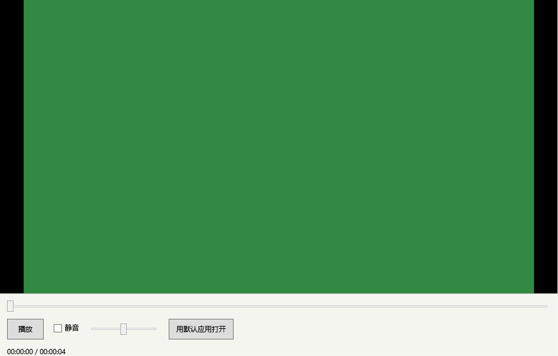
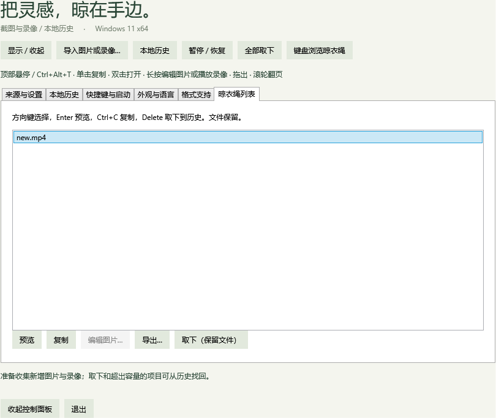

# 视频暂存范围：v0.10.0

2026-10-26，按用户确认的产品边界调整。项目负责将视频挂到晾衣绳，提供基本预览及文件流转，不承担视频编辑。

## 保留的功能

- 从指定目录收集新 MP4，或手动导入；生成缩略图和时长，挂到晾衣绳。
- 复制原视频文件、拖出副本、定位、保存到桌面、另存完整文件；不覆盖同名文件，原文件及卡片保留。
- 基础只读预览：播放/暂停、播放进度、音量、静音、默认应用打开和 Esc 关闭。
- 取下、容量淘汰、本地历史与重新挂上；预览期间继续使用文件保护机制。
- 图片预览、标注、裁剪、原图恢复及图片副本保存继续保留。

## 已删除的内容

- 视频预览中的起止时间输入、起点/终点按钮、片段预览、选区重置、剪辑导出及导出进度/取消 UI。
- 视频剪辑范围模型、剪辑请求/结果、处理器、编码工作进程、输出验证和剪辑副本入库逻辑。
- 剪辑专用诊断入口、核心范围测试和桌面测试脚本中的剪辑调用。
- 10 个翻译资源中各 29 条专用文案；当前每个资源 310 条，仍覆盖全部 11 种界面语言。
- 剪辑专用使用报告、截图和专项结果文件；现行需求、路线图和贡献约定不再把视频编辑列为迁移目标。

Windows 媒体 API 仍用于读取视频信息及缩略图。诊断中的素材生成器只生成测试色块和音轨，既有只读视频回归仍使用它；用户视频没有编码或剪辑入口。

## 升级与数据

本次不修改数据库结构，不迁移或清理媒体。旧版已经生成的视频副本继续作为普通视频保留、挂上和预览。历史记录、原视频和图片编辑关联沿用现有规则。

旧版本的综合测试记录是历史证据，可能包含当时的视频剪辑测试名称和计数，不代表当前功能。当前验证以本文件及 `v0.10-*.json` 为准；旧版行为仍可从 Git 历史追溯。

## 验证

Release 构建 0 警告、0 错误。本批相关回归通过 **397 项**：核心规则 139、存储与收集 91、媒体库 20、图片编辑 34、视频 30、功能兼容性 83。证据见 [汇总](evidence/v0.10-summary.json)、[视频](evidence/v0.10-video.json)与[功能兼容性](evidence/v0.10-functional.json)。

视频回归覆盖真实 H.264/AAC 解码、无音轨与竖屏、缩略图、播放/暂停/进度、完整文件复制与导出、复制式拖出、原文件和卡片保留、历史恢复及预览文件保护。界面渲染已核对：预览没有片段控制，键盘列表选中视频时“编辑图片…”禁用。

功能兼容性使用 `--compatibility-functional-test`，明确排除四项需要前台激活的夹具检查；它不是完整桌面兼容性验收。资源检查覆盖 11 种语言。

本批继续沿用 v0.9 尚未完成的真实环境验收清单，不重新宣称前台焦点、混合 DPI、远程连接、读屏及长期运行已全部通过。

## 使用本次版本

退出托盘中的旧版，将 `Clothesline-0.10.0-win-x64.zip` 完整解压后运行 `Clothesline.exe`。在设置中指定录像目录，或点击“导入图片或录像…”。右键视频选择“播放录像”进入只读预览；另存操作复制完整原文件。
